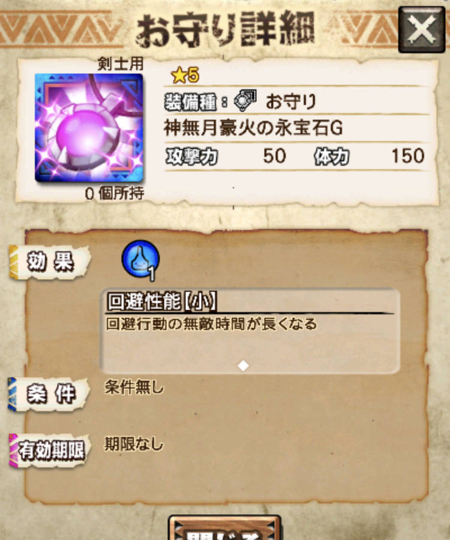
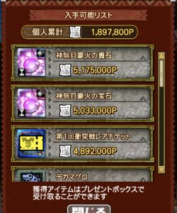
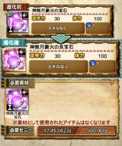

隠居者さん必見！！

本日始まりました第1回十六人衝突戦、

これまでの「十六人討伐戦」とは

また違ったルールになるのですが＼(^o^)／

今回の十六人で久しぶりに

無期限お守り

が全員に配られます＼(^o^)／

「配られる」と言っても

数時間はやらないとダメですが笑

新しいルールなので、

新鮮さから楽しめるとは思いますけどね＼(▽⌒*)>

そのお守りについて少し紹介させていただきます♪

## 第1回十六人衝突戦

### お守りの性能

水のお守りですね＼(^o^)／

攻撃力50技玉1の無期限の時点で

以前の無期限お守りと並びます(๑˃̵ᴗ˂̵)و

それに加え、体力150とスキルが一つ。。

これは確実にゲットしておきたいですね！！

水以外のお守りも今後実装されると思いますので

これからも楽しみですねー＼(^o^)／

### お守りの入手方法

十六人のクエストをクリアし、

そのクエストの自チームのランキングなどにより

取得できるポイントがあります( ´ ▽ ` )ﾉ

それを個人で集めた総数ポイントにより

お守りとその素材がゲットできます＼(^o^)／

私が現在、2時間して200万弱なので、、、

最終報酬の517.5万に到達するには、

多少の時間は必要ですね( ´ ▽ ` )ﾉ

そのまま計算すると5,6時間くらい。。

この最終報酬までに剣士とガンナーで

それぞれ2つずつの同じ名前のお守りが得られ、

それを2段階進化することととなりますー＼(^o^)／

こーなって

こーなる＼(^o^)／

### 予告編

ところで、皆さん

どのような編成で行っていますか？＼(^o^)／

私は初見から

自分がプラーヴァで

ティガ片手orマルガリスが3人

の編成でやっています＼(^o^)／

負け始めたら

新しいの考えようと思っていましたが、

このままで中々勝てるんですよね＼(▽⌒*)>

何十回もコンテしてるチームなどと

マッチングしたこともあったので

あまり

強いもの同士がマッチングする仕様にはなっていない

感じでしょうか＼(^o^)／

強いチームの方々と当たってみたい(๑˃̵ᴗ˂̵)و
