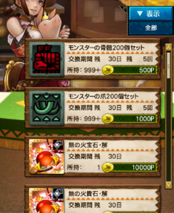
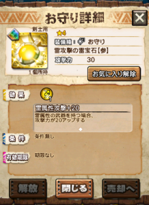

数ヶ月前より、交易店で交換可能なお守りが

ラインナップされていますが、

今回の値段は非常に安く、

たった数ヶ月前はこれ、10倍の価格でした！！

（お知らせ・最新情報で連絡あったのですが、
 完全にスルーしていました笑
 定例のお知らせかと思っていましたら、
 良く見ると十分の一の価格！！）

無期限お守りは、

過去の16人討伐クエストにおきまして入手可能でしたが、

第1回ごとに1属性という流れで実装され、

最近の16人討伐クエストでは入手できない装備となっておりました。

↓私が持ってる一番古いお守り

私は、モンハン大狩猟クエストとのカプリンクコラボで

きちんとログインし初めて、

（配信開始から、いつか始めようとたまにログインをしていました←）

そして、進撃の巨人コラボvol1からぼちぼちプレイしているのですが、

私にとっての初めての16人討伐クエストはクシャルダオラ、

この時はお守りを逃しましたが、

その次の16人からは皆勤で取得してきました♪

そんな私は、火属性と水属性のこの種のお守りを持っていません( ´ ▽ ` )ﾉ

。。ということで交易店行ってきます～＼(^o^)／

と行きたいところですが、

この価格変動は、今月の16人クエストで何かが変わる予兆だと予想して

あと半月ちょっと我慢してみます～( ´ ▽ ` )ﾉ

※お守りのラインナップ期間は「～8/31」です。

ちなみに、上の画像にも映っておりました

「モンスターの骨髄」と「モンスターの爪」は

主に武技レベルの強化で大量に必要となりますが、

前回と前々回の16人討伐クエストにて

大量に配られていましたアイテムとなります♪

次も配られるかどうかは未公表ですが、

もし不足している方は

今月の16人討伐クエストまで

様子を見ても良いかもしれませんね( ´ ▽ ` )ﾉ
