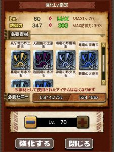
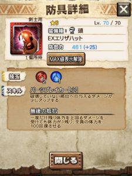
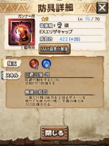
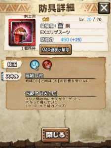
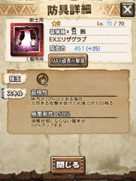
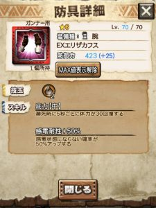
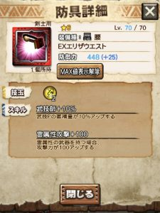
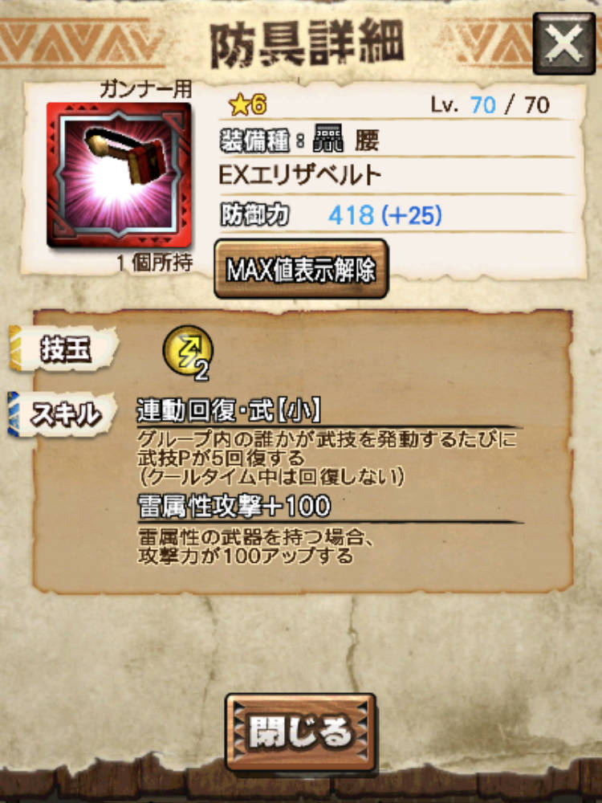
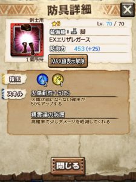
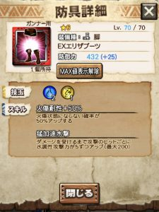

皆さん、ギルド討伐依頼Ⅱは行きましたか？＼(^o^)／

私はやっと20回ほど消化しまして、

アルゴー/エリザ装備も一通りは出ました( ´ ▽ ` )ﾉ

で、強化素材も途中まで確認できましたので

今回も、更新し始めようと思います＼(^o^)／

あと重ねてですが、

装備の評価も公開忘れていましたので

それもこの記事で(๑˃̵ᴗ˂̵)و

## アルゴー/エリザ装備

強化素材一覧表（特殊素材4種のみ）
 ※画像は古いですがそのうち置き換えます。
 青色アイコンの「探検隊の～」素材です。

  | Lv  |

  |

  |

  |

  |
  | 34  | 20  |    |    |    |
  | 35  |    |    |    |    |
  | 36  |    | 10  |    |    |
  | 37  |    |    |    |    |
  | 38  |    |    | 6  |    |
  | 39  |    |    |    |    |
  | 40  |    |    |    | 4   |
  | 41  |    |    |    |    |
  | 42  |    |    |    |    |
  | 43  | 20  |    |    |    |
  | 44  | 20  |    |    |    |
  | 45  |    | 20  |    |    |
  | 46  |    | 20  |    |    |
  | 47  |    |    |    |    |
  | 48  |    |    | 12  |    |
  | 49  |    |    |    | 4  |
  | 50  |    |    |    | 4  |
  | 51  |    |    |    |    |
  | 52  |    |    |    |    |
  | 53  | 30  |    |    |    |
  | 54  | 30  |    |    |    |
  | 55  |    |    |    |    |
  | 56  |    | 24  |    |    |
  | 57  |    |    | 20  |    |
  | 58  |    |    | 20  |    |
  | 59  |    |    |    |    |
  | 60  |    |    |    | 6  |
  | 61  |    |    |    |    |
  | 62  |    |    |    |    |
  | 63  |    |    |    |    |
  | 64  |    |    |    |    |
  | 65  |    |    |    |    |
  | 66  |    |    |    |    |
  | 67  |    |    |    |    |
  | 68  |    |    |    |    |
  | 69  |    |    |    |    |
  | 70  |    |    |    |    |
  | 計  | 120  | 74  | 58  | 18  |

強化素材はホーク/エコールと同じ個数でしたね＼(^o^)／

アイテムとしては、

旅団の～系ではなく、探検隊の～系で違う種類にはなります。

Lv61以降もホーク/エコールと同じかな？

こんな感じの玉のみなのでご安心を( ´ ▽ ` )ﾉ

### 各装備の評価

アルゴー/エリザの頭（剣士）

アルゴー/エリザの頭（ガンナー）

アルゴー/エリザの胴（剣士）

アルゴー/エリザの胴（ガンナー）

アルゴー/エリザの腕（剣士）

アルゴー/エリザの腕（ガンナー）

アルゴー/エリザの腰（剣士）

アルゴー/エリザの腰（ガンナー）

アルゴー/エリザの脚（剣士）

アルゴー/エリザの脚（ガンナー）

### クエスト周回

結局、月虫で耳栓も感電耐性もなしでやっています( ´ ▽ ` )ﾉ

ギルクエⅡ「こんな感じで周回してますよ」って動画も貼っておきます～♪

▼動画「ギルド討伐依頼Ⅱ 20回目」【再生時間 : 約280秒】
