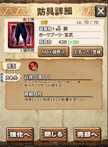
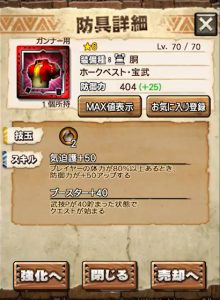
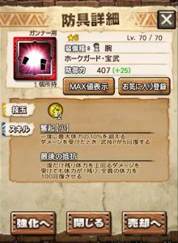
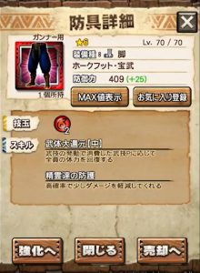

待ちに待ったホーク エコールの進化情報＼(^o^)／

予告が早かった分、

すごく期待が膨らんでいたことだと思います♪

素材も下手に使えず、

大事に保管してた人も多いはず( ´ ▽ ` )ﾉ

でも安心してください♪

それ相応の性能で実装してくれそうですー＼(▽⌒*)>

まぁそりゃあそうです♪

進化前で既にこんなとんでも防御だったんですから

それが進化するのだから

そりゃ強いですよね＼(^o^)／

防御値だけでなく、スキルも適正スキル揃いです♪

ってわけで、

進化後の性能を順番に見ていきましょう＼(^o^)／

あ、剣士とガンナーでスキルが異なるので

別々に見ていきましょう＼(^o^)／

## ホーク エコール進化の性能と評価

### ▼剣士装備

#### ホーク エコールの頭

静養30！！！！

ぶっ壊れ性能ですね＼(^o^)／

たとえば、

シルソやゴルナなどの多エリアクエストで

テガ大剣を担いで、

七つの大罪の水胴を装備する。

すると各エリアで武技できて会心。。

楽しそう。。笑

多エリアでなくてもブースター30相当なので、

使える機会はさらに増えるでしょう( ´ ▽ ` )ﾉ

ライバルは戦獄の頭ですねー。

### ホーク エコールの胴

ブースター40の土胴。

獅子の胴がブースター50なので、

技玉で選ぶことになってきますね( ´ ▽ ` )ﾉ

感電耐性もついていますので

感電攻撃が相手の場合は

これをベースに組むことも多いです♪

ライゼクスの時代に、

これを完成させてるか否かで

大きく区別されましたよね♪

次の雷モンスまでには作っておきたい防具(๑˃̵ᴗ˂̵)و

#### ホーク エコールの腕

奮起と転身回復の雷腕♪

スキルの組み合わせは非常に良いです＼(^o^)／

進化することで転身回復が中になりましたね♪

回復量としては、50→80の変化となります。

雷だけに限らず、腕は全体的に使えるものが少ないため

余裕があれば作っておきたい一品！！

スキルは上級者向けとなりますが、

使いこなすとバカ強いです＼(▽⌒*)>

奮起中とはならなかったのも納得の防具。

#### ホーク エコールの腰

剣士装備の中で、唯一スキルが変わらなかった腰。

技玉が増えました( ´ ▽ ` )ﾉ

どうしても土の技玉が1足りない

という状況になるまで進化しなくても良いですね笑

#### ホーク エコールの脚

強化は一番最後にしても良い防具＼(^o^)／

進化しても順位は変わりませんでしたね。。

技玉も増えると思っていましたが残念( ´ ▽ ` )ﾉ

ホーク エコールは強化条件がかなり厳しいです！

本当に使えるのかの判断は徹底した方が吉。

### ▼ガンナー装備

#### ホーク エコールの頭

高揚が気迫になりました♪

ガンナーならどちらでも良いと

思うかもしれませんが、

結構な違いです＼(^o^)／

足踏みなどで高揚が切れることもありますから♪

まぁあまり大きな変化ではないですね( ´ ▽ ` )ﾉ

でも元々強い防具！！

#### ホーク エコールの胴

剣士と同様にブースター40となりました♪

防御カッチカチなガンナーを作りたい場合は重要となる防具( ´ ▽ ` )ﾉ

ヘビなどは避けられない攻撃があったりしますしね！！

会心共鳴や隠密が色んな部位で付いてきて

スイッチできるようになってきたので

このようにベースとなる防具があると

まとまりが良くなりますね＼(^o^)／

#### ホーク エコールの腕

奮起中にしてもらいたかったですねー＼(^o^)／

スキルの組み合わせは良いですが、

他の部位が強いので後回しになりがち。

ガンナーなので奮起発動はしやすいですね( ´ ▽ ` )ﾉ

#### ホーク エコールの腰

こちらも剣士同様にスキルが変わらず。

しかし、氷はもちろん、

土もガンナーは強い武器が現在は多いので、

使う機会は進化前よりもさらに増えるはずです＼(^o^)／

胴と同様にベースとしやすいエース防具♪

#### ホーク エコールの脚

防御系Wスキルの脚。

サポート系の武器とは相性が良かったりします♪

いつか使わなくなるスキル達なので

後回しでも良いですねー！！

### ホーク エコール進化についての注意点

ホーク エコールが星5から星6になるということは、

レベル60にしないと進化できない

ということですよね＼(^o^)／

素材が不足していて

レベル59で止まってる

なんて人も今は多いと思います。

俗に言う「わかめ」が不足するんですよね( ´ ▽ ` )ﾉ

あとは、星5から星6のようにランクが上がる場合は、

進化できても

強化できないと防御が減る

ということもきちんと知っておいてください( ´ ▽ ` )ﾉ

まだ強化素材が判明していませんが、

自分が

どこまで強化できるかを把握してから進化する

ことは大切です！

進化できても防御が低くて使えなくなった

なんてことになるとショックですよね＼(^o^)／

ホーク エコールの強化素材については

下記リンクにまとめておきますー＼(^o^)／

[⇒ホーク エコール装備（防具）の強化素材](../../../mhxr/armor/hawk-ecole-lvup/)
 [http://hazieta.com/mhxr/armor/hawk-ecole-lvup/](../../../mhxr/armor/hawk-ecole-lvup/)
