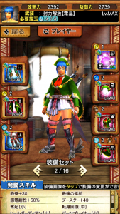
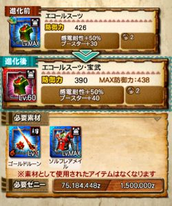

2017年7月に予告されておりました

ホーク エコール防具の進化も

Ver6.4アップデートで実装され、

進化素材と強化素材（Lv60→70）も

本日やっと明らかになりましたね＼(^o^)／

特に強化素材などは、

私も含め、周りでも

びびってた人が多かったのですが

難易度は高くありませんでした♪

私も既にこのとおり＼(^o^)／

## ホーク エコールの進化

### 進化素材について

進化素材は予告通り豪火種の装備が必要で、

プラス値は全てプラス25が必要でした笑

まぁ良く考えたらそうなりますか＼(^o^)／

種類は以下のようになっています♪

  | ホーク部位  | 進化素材（全て豪火）
  | 頭（剣）  | チャアク、頭（剣）
  | 胴（剣）  | ランス、胴（剣）
  | 腕（剣）  | 太刀、腕（剣）
  | 腰（剣）  | 大剣、腰（剣）
  | 脚（剣）  | ハンマー、脚（剣）
  | 頭（ガ）  | 片手剣、頭（ガ）
  | 胴（ガ）  | ガンス、胴（ガ）
  | 腕（ガ）  | 双剣、腕（ガ）
  | 腰（ガ）  | ライト、腰（ガ）
  | 脚（ガ）  | ライト、脚（ガ）

※豪火装備は全てプラス25必要です。

豪火武器は全9種なので、

ライトボウガンだけ。。。笑

 各防具の評価については下記の過去記事に( ´ ▽ ` )ﾉ

[▼ホーク エコールの進化 スキルと性能の評価](../../../mhxr/armor/hawk-ecole-evl-ability/)
 [http://hazieta.com/mhxr/armor/hawk-ecole-evl-ability/](../../../mhxr/armor/hawk-ecole-evl-ability/)

上記の過去記事にも書かせてもらったと思うのですが、

星5→星6のような進化時には

このように強化しないと

防御力は下がります

進化させる前に計画しましょう(๑˃̵ᴗ˂̵)و

あと、豪火の武器を素材にしますが、

レベルやプラス値はいつでも強化できますが

武技のレベルアップには制限があります

要は武技書という素材が必要で

その武技書は十六人討伐戦で

限定的に排出される素材だからです( ´ ▽ ` )ﾉ

現在の第17回十六人討伐戦でも排出中ですね！！

チャアクや大剣は上位でも現役武器です♪

レベルMAXにできなくなった

なんてことは無いようにお気をつけて( ´ ▽ ` )ﾉ

### 強化素材について

強化素材に、

「旅団の〇〇」というギルクエでしか手に入らない素材は

必要ありませんでした！！

シャガル以降の玉素材で強化でき、

詳しくは以下の通りです＼(^o^)／

  | Lv  | 強化素材（全て玉）
  | 61  | 炸裂ベリ亜×2
  | 62  | シャガル×2
  | 63  | 炸裂ラギ亜×2
  | 64  | ライゼクス×2
  | 65  | 炸裂ティガ×2
  | 66  | タマミツネ×2
  | 67  | 炸裂ブラキ×2
  | 68  | ディノバルド×2
  | 69  | 炸裂アグ亜×2
  | 70  | ガムート×2

レベル60までの強化素材は下記の過去記事で( ´ ▽ ` )ﾉ

[▼ホーク エコール装備（防具）の強化素材](../../../mhxr/armor/hawk-ecole-lvup/)
 [http://hazieta.com/mhxr/armor/hawk-ecole-lvup/](../../../mhxr/armor/hawk-ecole-lvup/)

ホーク エコールの装備は、

特に「あまりガチャしない人」にとっては

とても大事ですよね！！

強化頑張りましょう＼(^o^)／
