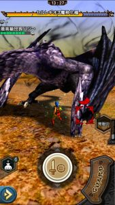
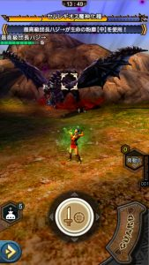
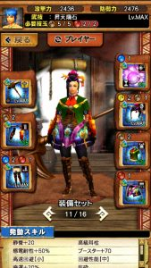
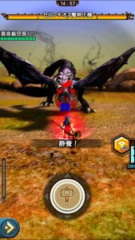
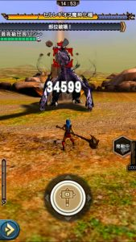
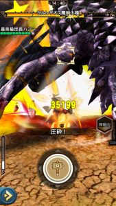
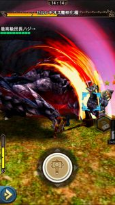

七つの大罪コラボの挑戦クエストについて、

団員さんが体力80%残しのクリアに難航していましたので、

色々試してみました＼(^o^)／

操虫棍は問題なくクリアできると思いますので、

虫以外を順番に一つずつ～( ´ ▽ ` )ﾉ

## 片手剣（刃折れの剣・大罪）での挑戦

最終進化はしない人の方が多いと思いますので

進化前の状態でプラカンして

HR339なら攻撃力は2200オーバーとなりますね！！

これでいきましょう♪

あとは狩力の蓄積条件がガード成功となっていますので、

もしあるなら

ホーク エコールの腰を組み込むことができれば、

ヒールガーディアンが付いていますので

成功率は格段に上がると思います＼(^o^)／

腰の有無は関係なく重要となりますのが

どの攻撃をガードするか

狩力なしでも半分の火力はでますので、

自分の体力に余裕がなくなってきたら

ガードなしで長期戦にもちこむ手段もありますね＼(^o^)／

ここから、ガードすべき攻撃っていうのを紹介させていただきます( ´ ▽ ` )ﾉ

#### ①足踏みをガード

レギオスの攻撃で

尻尾のなぎ払いを2回おこない、

360度回転するような攻撃があると思います。

このとき、なぎ払いの発生時に足踏み判定ありますので

これはガードチャンスですね！！

少し、、スクショ遅かったですね笑

回復の緑なオーラが見えるのが

ヒールガーディアンの回復エフェクトです～♪

#### ②風圧をガード

レギオスも飛竜なだけあって

風圧があります♪

ただかなり頻度が低いですけど笑

私が把握してるのは一つ、

バックブレス後の着地

でもあまりこのアクションは行いません＼(^o^)／

発生したときは、見逃さずに

しっかりガードしておきたいですね！！

#### ③通常咆哮をガード

開幕は咆哮確定です。

ただ猶予が僅かなので

間に合わなかったら間に合わなかったで♪

こんな感じでしょうか♪

あとは体力に余裕があるうちに

多段ヒットの裂傷攻撃でガード回数を稼いだり♪

武技は飛んでるところを打ち落とすように使用し、

ダウンしたところに連撃を浴びせましょう♪

あとは攻撃判定のある咆哮以外は

基本的に回り込みで避けられるので

どれだけミスの数を減らすことができるかですね！！

攻撃判定のある咆哮は予備動作があるので

落ち着いて離れるだけで回避できますよねー♪

そのとき、近づけませんが隙だらけなので

ここが生命の粉塵を使うチャンスです♪

あと粉塵は倒したあとにがぶ飲みすることを

忘れずにですね！！

## ハンマー（戦鎚ギデオン）での挑戦

ハンマーが意外と楽です♪

まずは準備として

ブースター90を積みます＼(^o^)／

防御ははっきり言って要りません＼(^o^)／

ブースターだけで大丈夫です♪

可能なら回避性能があると楽ですね！

レギオス相手なのでなくても。

開幕に武技を打ちたいのですが、

まっすぐ近づいて4歩くらいのこの位置！

押し寄せる武技の一発目がぎり届くくらいの位置となります( ´ ▽ ` )ﾉ

ここで打つと5ヒットさせることができます(๑˃̵ᴗ˂̵)و

で5ヒット目で尻尾が切れます

尻尾切れてバタバタしているところへ

角砕き※

※ここで頭にヒットさせるのが難しいみたいですが、
 頭はフリフリするので、頭タゲは止めて
 胴タゲにして頭の動きに合わせて叩くと大丈夫です♪

ここで半分減っていますね＼(^o^)／

であとは立ち回りながら数発だけ頭叩くとスタン。

あとは角砕きなどすれば

次の武技も貯まってくると思います＼(^o^)／

## 弓（双弓ハーリット）での挑戦

弓は最もPSが要求されると思いますね( ´ ▽ ` )ﾉ

弓はあらゆる攻撃を避けながら

ノーダメで勝つ

これが難易度は高いかもしれませんが

最も楽というかそうするしかないと思います笑

回避性能と気迫や高揚、会心でいきましょう！！←
