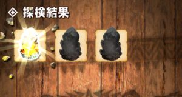
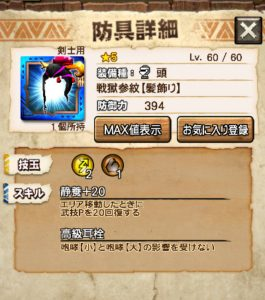
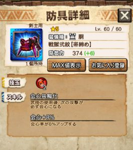

七つの大罪コラボもイベントクエストが終了し、

あとはイベントポイントの交換のみとなりましたね＼(^o^)／

どのイベント防具を作成するか悩みますね( ´ ▽ ` )ﾉ

とりあえず！

イベントポイントの交換は

本日中となっていますのでお気をつけて！！

## 七つの大罪イベントの精算

### 七つの大罪イベント防具の作成

さて皆さん、

欲しい防具は完成しましたでしょうか？＼(▽⌒*)>

私はというとこんな感じ。

最終段階は、剣士頭を除き作成。

他は、3段階目の剣士脚と

4段階目の剣士脚は確保し、

3段階目のガンナー頭も一応作成、

そして、

余ったホイップと腐るほどあった防具で

3段階目を作った感じですね( ´ ▽ ` )ﾉ

作った順番はこんな感じ～

  |    | 剣  | ガ
  | 頭（心）  |    | ⑧
  | 頭（技）  |    |
  | 頭（体）  |    | ③
  | 胴（技）  |    |
  | 胴（体）  |    |
  | 胴（心）  | ④  | ⑤
  | 脚（体）  | ⑥  |
  | 脚（心）  | ⑦  |
  | 脚（技）  | ①  | ②

どれを作ろうか、まだ迷っている人も多いみたいなので

参考になればと思いますー♪

内訳はこちらをどーぞ＼(^o^)／

[⇒七つの大罪コラボ イベント防具どれを作る？](../../../mhxr/collabo/seven-deadly-sins-equip-which/)
 [http://hazieta.com/mhxr/collabo/seven-deadly-sins-equip-which/](../../../mhxr/collabo/seven-deadly-sins-equip-which/)

内訳と結果を見比べていると、

会心の土胴を作れなかったのですねー＼(^o^)／

どうしてそうしたのかと言うと、

まずこれを報告させて頂かないといけません←

### 引きの良い一日 ～第4章～

今開催中のマグナソルナのニャン検隊
 （レアは超レアとマグナソルナの防具のみというニャン検隊）

でですね、まさかの一歩目に

1回派遣で2個ゲットだから

3個あるということはマグナソルナ確定？！

胴～＼(^o^)／

マグナソルナの中では、1,2番のアタリです＼(^o^)／

1位タイは氷共鳴の腕ですよね(๑˃̵ᴗ˂̵)و

3,4番となる頭や腰も強く、

実用的なのでマグナソルナは狙う価値あります～♪♪

と思いながら2島目へ進めていると

奇数個ってことはまたマグナソルナ確定？！

腰～＼(^o^)／

まぁこっちはフィル腰があるので

ほとんど使わないでしょう( ´ ▽ ` )ﾉ

進化待ちか

どうしても氷技玉が足りないときに♪

### 七つの大罪イベント防具の作成区別基準

という訳で、

マグナソルナの腰は置いときまして

会心胴がこのタイミングで現れた訳ですよ＼(▽⌒*)>

（プラス2になっているのは、腰の後
 日々のニャン検隊でまた胴を引きました笑）

性能はご存知の通りこんなですが、

密かに土技玉も保有しているのです♪

つまり、今回のイベント胴（体）と比べると

技玉が1つ少ないので

完全上位とはなりませんが、

技玉が不足しない限りはマグナソルナを使う訳ですね( ´ ▽ ` )ﾉ

（大好きな[転身回復](../../../mhxr/armor/passive-heal-skill/)も付いていますし←）

こいつを2つも引き当てた理由を考え

イベント胴はスルーすることにしましたとさ。

そんな切り分けも大事ですよね♪

という流れでその他には、

どれも内訳でも紹介させてもらったと思いますが、

戦獄の頭。

これもイベント頭（体）の完全上位ではありませんが、

とくに隠密の不要な剣士にとっては、

技玉が1つ少ないだけですので上位防具になりますよね！

私がイベント頭（体）をスルーしたのもこいつの存在のためです♪

つづきまして～

戦獄の胴。

これは技玉も2なのでイベント胴（技）の完全上位になりますね！

さらにつづきまして～

ホーク・エコールの剣士頭。

これは無課金でもゲットできる防具になります♪

技玉も2なので、第2スキルの錬成を無視すると

イベント頭（心）の完全上位となりますね＼(^o^)／

しかし、ホーク・エコールのガンナー頭はスキルが全く異なり、

静養ではありませんので注意。

私がガンナー頭だけ作っているのもそのためです♪

逆に～

バリアロ亜の脚。

これはイベント脚（心）の完全下位防具です！

私も、イベント脚（心）はホイップに余裕があれば

と考えていましたが、余裕ありましたので作った感じですね♪

防御高いだけなので、重要度は低いです。

（イベント脚（心）には[転身回復](../../../mhxr/armor/passive-heal-skill/)が付いています笑）

### 七つの大罪イベントポイントの余りについて

あと残りのポイントは火竜素材（島素材）に変えました( ´ ▽ ` )ﾉ

イベントのクエスト報酬でも少しずつ出ていましたので、

しばらくは安泰ですね＼(^o^)／
