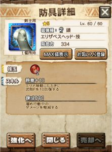
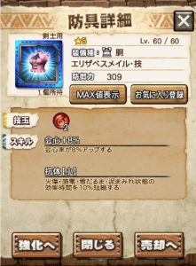
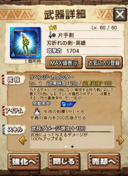
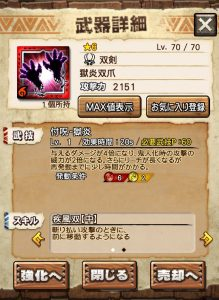
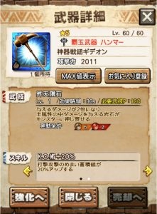
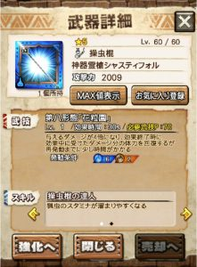
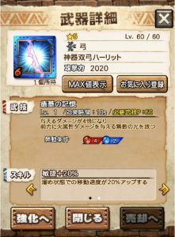

今回の七つの大罪コラボのイベントは少し特殊です＼(^o^)／

武器はいつも通りな感じですが、

防具の方、

簡単に言うと剣士だけで9種類あります笑

剣士・ガンナーでなんと18種類！！

しかし、分岐進化ではなく、

最大5段階進化！！

。。。笑

これは忙しくなりそうですね～( ´ ▽ ` )ﾉ

今回は（というかエヴァ以外はいつも通り）

ニャン検隊武器がイマイチな分、

通常クエストの防具が強くて多種類なので

イベントが盛り上がりそうですね！！

お守りは頑張って引き当てたいところ＼(▽⌒*)>

## 今コラボ装備の進化手順

防具の話になります♪

今回、ニャン検隊は武器のみです( ´ ▽ ` )ﾉ

防具は通常クエストでゲットできるものとなりますね♪

その防具！

今回は前述もさせていただきましたが

最大5段階進化！！

どういうことかといいますと、

前回コラボなどは

星4⇒星4⇒星5⇒星5

だったのが今回

星4⇒星5⇒星5⇒星5⇒星5

となります笑

下記に一つ一つ紹介させていただきますが、

途中の3段階目や4段階目が重要だったりもします( ´ ▽ ` )ﾉ

これまでも高価な新規アイテムであった

俗に言う「ホイップ」が今回も同価値であります♪

3段階目の進化に3個、4段階に9個、5段階に18個、、

そんな感じですので、

自分にあった防具および将来を見据えた防具が

今まで以上に選べる仕様となってますね！！

18種類を全部作るなんて暴挙も良いですし

隠密剣士なんていらない

水の静養や火の会心は持ってる

など優先順位を付けて目標のところまで

作るのも大事ですね！！

防具は防御力よりもスキル

これは誰もがいずれたどり着くところです＼(▽⌒*)>

きちんと漏れなく18種類を見ておきましょう(๑˃̵ᴗ˂̵)و

あとニャン検隊武器の話、

今回、2段階進化となりますが、

2段階進化には2つ目のニャン検隊武器が必要です！！

その分、多少配られる予定ですが、決して

同じ武器をゲットしても＋値にはしないように！！

皆さん、今まで通り合体しまうことはないようお気をつけて( ´ ▽ ` )ﾉ

## 通常クエストで入手可能な装備

水の静養はホーク エコールと被ります。

間に合せにどーぞ( ´ ▽ ` )ﾉ

火の静養はゴールドルナと被ります( ´ ▽ ` )ﾉ

ゴールドルナの頭は技玉1で第二スキルもありません、

そして、もちろん今回の方が防御は高いので

ゴールドルナヘルムの完全上位版となりますね！！

錬成中はハンマーや蛇、弓で

ダメージ抑えたい人には良いですね！

土の静養は戦獄の頭と少し被りますね！！

しかし、ここで急に隠密となるので、

ガンナーではこれだけで

隠密もブースターも付き技玉も2なので、

使う機会はあります＼(^o^)／

抗体はおいといて、火の会心♪

しかし、戦獄の胴と被りますし、

胴の会心は多いので

近いうちに使わなくなってしまう

そんな装備ですね( ´ ▽ ` )ﾉ

抗体はおいといて、土の会心♪

会心は総ダメを大きくあげるので

手数の多い武器

土なら例えばフィルティの弓、レアライトなどには

かなりの効果が期待できますね＼(^o^)／

水の共鳴。

ここで初めて、

ついに会心共鳴化が配られます＼(^o^)／

プラーヴァ持ってるけど共鳴がない

ティガ大剣をカンストできたけど共鳴がない

なんて人には最高のサプライズではないでしょうか！！

さらに火傷耐性も付いてるので

先月（7月）の炸裂ブラキなどの攻略にぴったりですね♪

転身回復と迅脚♪

迅脚は、これがないと難しいハメなどがありますので

土の脚として種類が増えるのは良いですね！！

ネフ腰とスイッチしましょう＼(^o^)／

転身回復は、

七つの大罪の前記事でも書かせてもらった気がしますが、

転身回復の防具を使う機会は増えてきておりまして、

転身回復をつけていなくても

コマンド入力してしまっている人も多いと思います♪

（私は常に入力しています笑）

せっかく入力してるなら

小でもいいから付けておきたいですよね(๑˃̵ᴗ˂̵)و

こちらは進化してもスキル変わらずですが水♪

水の迅脚はバリアロ亜がそうでしたね！！

防御も高く第二スキルもありますので

ルドロスUグリーヴ・銅の完全上位防具＼(^o^)／

これはかなりお世話になった防具って人も多く

たとえば、テガハンマーで

開幕のタメ2を確実に当てたいときなんかに良く使用されます♪

防具に付くのは初な高速回避中と、

武器にも防具にも初となる転身回復中ですね！！

とても実践的で

多くの人にとっては、今回の最良防具になるでしょう＼(▽⌒*)>

高速回避中は機拳アームストロングについていましたね！

双剣の鬼人化中のステップループは異常な速さ！！

しかし、火の脚は回避系のスキルをガメていますね～( ´ ▽ ` )ﾉ

回避性能中も回避距離中もあり、

どれを使うかとても迷いますね＼(^o^)／

もう一つのスキルは「全方位ガード」。

360°からの攻撃をガードできるスキルですね！！

武技ダメージ増加100%はとんでもスキル＼(^o^)／

狩力の蓄積条件が「ガード成功」なので

全方位ガードは相性抜群！

狩力により最大6倍、

武技ダメージ増加100%なので12倍！！

中ダメージ一閃なので

実はまだ火力足りませんね笑

マルガリスなどとコラボしてみましょう＼(^o^)／

ちなみに、

今回は必要武技Pは最高で中々減りまして、

70まで減らすことができます♪

## ニャン検隊で入手可能な装備（武器）

今回、基本的に危険度8用の武器となりますね！！

双剣はガムートや炸裂アグ亜、

ハンマーはライゼクスや炸裂ラギ亜、

操虫棍はディノバルド、

弓は中途半端ですが、幅広く

タマミツネや炸裂ティガ、シャガルや炸裂ベリ亜

という感じ。。

それほど火力はありません( ´ ▽ ` )ﾉ

もう一つのスキルは「態勢維持」。

双剣ゲージが攻撃を受けても減少しないスキルですね♪

双剣は鬼人化してなんぼなので

鬼人化を手助けしてくれるスキルは大事ですね！

性能はオールマイティ。

もう一つのスキルは「圧砕」。

スタンプの威力が上がるスキルですね！！

覇玉ハンマーなので、使い勝手は良いです♪

武技は押し寄せる系の中ダメージ版♪

それでも火力は見込めないので

サポート武器として割り切って使用しましょう＼(▽⌒*)>

土のハンマーは、いつも良い性能ですね～♪

実はこれ、アイコンで予想できるかもしれませんが、

長リーチ武器です＼(^o^)／

もう一つのスキルは「武技師20%」。

とってもオールマイティ笑

アイコンの見た目は虫が居ないので

ランスのような見た目←

このスキルはクリーガーチャアクと似たようなスキルで、

奮起と相性がいいですね！！

必要武技玉的に付けにくそうですけど笑

タマミツネの操虫棍にスピードは劣るものの

総合的火力は上回りますので、

現在、タマ虫を使用している人は

次のステップとしてこちらにシフトすることはできそうですね！

ギルド討伐依頼クエストが

ノーコンクリアできない人はすごく安定するかも♪

もう一つのスキルは「流し撃ち」。

曲射の適正距離が少し広くなるスキルですね＼(^o^)／

予想よりは普通でしたね！！

武技時間が短いので注意と慣れが必要。

バリア（鋼膜個体）に有効。

## イベントクエスト（セルレギオス魔人化種）

ついでにイベントクエストの方も少し触れておきます( ´ ▽ ` )ﾉ

特攻武器は

片手剣、双剣、ハンマー、操虫棍、弓

とコラボ武器が全て該当しています♪

というか実は

特攻武器でしか出撃できない仕様

となっています！！！

レギオスの頭の部位破壊も大事なので

編成を考えるの楽しみですね♪

フィル太刀とガンスはこの仕様で封印されました♪

クリ虫（レーゲン）やロンギヌスやマルガリス、

ポニョ（マーガリタ・ボニニョ）やティガ片手、

クリハンマー（フリーゲン）や竜巻ハンマーなど

が定番になりそうですね♪

あとは今回のシャスティフォルやタマ虫、

ガンナー枠として、

ガンナーは弓限定となりますが

フィルティやタマミツネあたりでしょうか＼(^o^)／

あとコラボは関係ないですが、

今月のカーニバル狩猟祭の交換期限が

本日8/9までとなっているので

皆さんお気をつけて～( ´ ▽ ` )ﾉ
