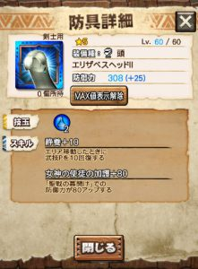

Ver6.3の大型コラボイベント♪

七つの大罪 聖戦の予兆（しるし） でしたねー＼(^o^)／

確かに大型！！

そのコラボイベントで入手可能な装備などについて、

今ある情報を貼っていきますねー＼(▽⌒*)>

[20170809追記]
 装備の性能など確定しました。
 ▼最新の情報は下記リンクへ
 [⇒七つの大罪コラボ 装備詳細と評価
 ](../../../mhxr/collabo/seven-deadly-sins-equip-ability-detail/)[http://hazieta.com/mhxr/collabo/seven-deadly-sins-equip-ability-detail/](../../../mhxr/collabo/seven-deadly-sins-equip-ability-detail/)

## 通常クエストで入手可能な装備（武器、防具）[2017年8月3日時点]

#### 刃折れの剣（片手剣）

久しぶりの狩力ですね♪

狩力マックスで6倍の一閃！！

まだ進化途中までの情報ですが、

最終進化が楽しみですね♪

武技レベルはこれまでと比べると

マックス値が高め。

#### メリオダス エリザベスの頭

静養！！

水なので、ホーク エコールと被りますが

最終進化に注目ですね♪

#### メリオダス エリザベスの胴

会心！！

湯浴みの胴が水の技玉1の会心10%なので

玉が多い分、使う機会はありそうですね！！

これも最終進化に期待＼(^o^)／

#### メリオダス エリザベスの脚

転身回復！！！

最近は、転身回復付の防具を使う機会も多数あり、

転身回復つけてなくても

咄嗟にコマンド入力し続けている人も多いはずww

せっかく入力してるなら

小でもいいから付けておきたいですよね笑

私はホーク エコールの腕を

隙あれば付けています♪

これも第2スキルによっては

使っていける防具に成り得ますねーーー( ´ ▽ ` )ﾉ

## ニャン検隊で入手可能な装備（武器）

#### 獄炎双爪（双剣）

火属性の双剣です♪

詳細はのちほど＼(^o^)／

#### ギデオン（ハンマー）

土属性武器で一閃武技ですね♪

#### シャスティフォル（操虫棍）

水の操虫棍ですね♪

#### ハーリット（弓）

火属性の貴重な弓ww

コラボイベントの弓は

いつもトリッキーな性能だから最も期待！！

## セルレギオス魔人化種

コラボ武器が水属性なので、

この魔人さんもレギオスと同じく火属性の可能性高いですね！！

レギオスとは違う特攻武器が来ますので

新しい編成が組めるの楽しみですねー＼(^o^)／

レギオスはガンス4や3が多かったですか！！

初心者さんの部屋では開幕穴のハメが定番でしたね( ´ ▽ ` )ﾉ

続報をお楽しみに！！
