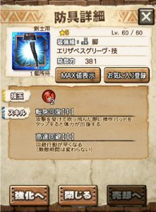
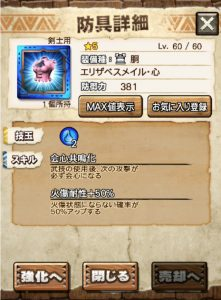
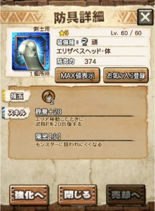
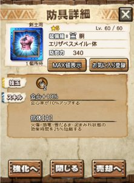
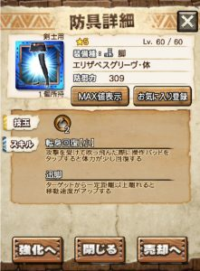
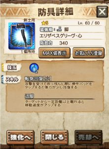

七つの大罪コラボも二日目を終えようとしています～♪

私は基本的に2倍時間をがっつりして

それ以外は、暇があれば～気が向いたら～

という感じで( ´ ▽ ` )ﾉ

そろそろ

本腰入れるのか

まったりするのか

を決めるために！進化させる防具の

優先順位を決めていきたいと思います～＼(^o^)／

装備一つ一つの評価は[こちら](../../../mhxr/collabo/seven-deadly-sins-equip-ability-detail/)で書かせてもらいましたが、

今回は私個人の目標となってしまいますので

参考程度によろしくお願いいたします！

興味ない方はスルーしてくださいませ～( ´ ▽ ` )ﾉ

## 現状の情報まとめ

残飯ポイント 5800万
 （今回のポイント、今初めて確認しましたけど「残飯」なんだww）

シルソ遭遇 7回
 （回数はかなり行きましたが、中々の低確率ですね！！）

ニャン検隊で拾った 生命の泉の杯 5個
 （この考察のために3島目まで行ってみたらホイップでした♪
 正直、「次の確定報酬2倍」が当たりだったんですけどね笑）

情報は以上ですか♪

ポイントは生命の泉の杯（いわゆるホイップ）に換算して、

挑戦クエでもらった20個も足すと

90個

プレゼントなどを除いて、

通常クエストで集めたホイップの数は、

65個

残り8日なのでこのまま行くと

ホイップ数の総計は～

じゃなくて

350個

ですね＼(^o^)／

１部位にホイップちえみは最大30個必要ですので、、、

このまま行けば、割と多くの部位が作れますねー！！

今回、良いお守りを頂いてはいますが、

エヴァのときより

中々サボっても良い感じだとおもいます～♪

## 進化させる防具（優先順）

①剣士脚（5段階目）必要ブルゾン : 30

やっぱこれですねー♪

初の転身回復中と

防具に初の高速回避中＼(^o^)／

これを履いて双剣で回避連発とかしてみたいです♪♪

②ガンナー脚（5段階目）必要ブルゾン : 30

スキルは剣士と同じなので画像なし

高速回避中はガンナーでも魅力的♪

回避というかステップはライトボウガンでは大事ですよね！

ステップ中に弾切り替えとか、

覇玉ライトの特殊アクション、

あとはステップファイアのスキルとも相性いいですね＼(^o^)／

また、回避距離などとコラボして、

蛇（ヘビィボウガン）などでも移動手段に使えますねー＼(^o^)／

高速回避小と回避距離小のコンボでも、

走るハンターと同じ速度で移動できるくらいです。

相当速そうですねーー！！

③剣士胴（5段階目）必要ブルゾン : 30

水の共鳴ですね♪

基本的には、戦獄の胴があるので活躍が減りますが、

水の技玉が要求されるケースでの会心共鳴

。。あると思います！！

ティガンスとかも技玉の要求が激しかったですし、

今はそれ以上に要求される武器も多く存在します。

来月の新モンスもまだ装備の内容までは公開されていませんが、

これまた水モンスで

必要技玉も多い可能性は高いですよね！！

④ガンナー頭（5段階目）必要ブルゾン : 30

※画像は剣士のもの（スキルは同じ）

静養隠密です。

この組み合わせは初で、

1部位でこの2つを満たせるのはかなりでかいです＼(^o^)／

土で静養となると、戦獄の頭と少し被りますが、

隠密があるので剣士側はおいといてガンナー側は評価が高いです！

⑤ガンナー胴（5段階目）必要ブルゾン : 30

スキルは剣士と同じなので画像なし

ガンナーの水共鳴です。

主にヘビ用となりますね♪

今は特に使う機会ありませんが、

今後のためにっ(๑˃̵ᴗ˂̵)و

⑥ガンナー胴（4段階目）必要ブルゾン : 12

※画像は剣士のもの（スキルは同じ）

土の会心です。

会心の強さは言わずもがな。

胴に会心付きは多いですが、

土の技玉2で10%は現状最高値( ´ ▽ ` )ﾉ

⑦剣士胴（4段階目）必要ブルゾン : 12

ガンナー胴（4段階目）に同じ。

⑧剣士脚（3段階目）必要ブルゾン : 3

迅脚は、ハメやコンボにはかなり重要な場面があります♪

ハンマーの開幕にタメ2を確定ヒットさせたいとき

などに良く使用されますね！！

土の迅脚で、脚部位は初めてなので以降の進化より高評価。

⑨剣士脚（4段階目）必要ブルゾン : 12

バリアロ亜（鋼膜個体のロアルドロス亜種）の脚と被りますが、

防御も高く転身回避がついており、完全上位となるため＼(^o^)／

⑩ガンナー頭（3段階目）必要ブルゾン : 3

※画像は剣士のもの（スキルは同じ）

剣士側はホーク エコールがあるため不要ですが、

ガンナーのホーク エコールは静養ではないため。

静養10であるため、使える機会はかなり限られてくるが、

やはり技玉2は大きい。

## まとめ

優先順位考えながら挙げさせてもらいましたが、

合計10部位となりました。

ホイップの総数は

192個

よって残り8日間、

50%くらいのやり込み度で行かせていただきます！！

なんとか時間が足りそうな数字になって良かった笑
