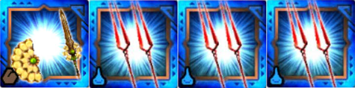
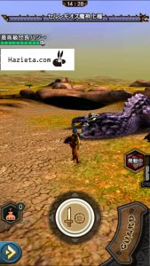
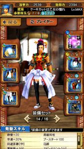
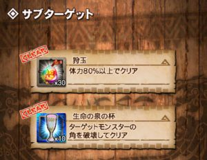
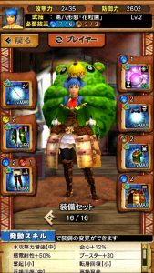
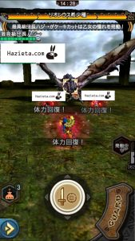

七つの大罪コラボのイベントクエスト、

16:00からの初見の部終わりましたね＼(^o^)／

正直、、、ロンギばかりになりそうですね笑

拘束で倒せていまいました( ´ ▽ ` )ﾉ

## 高速周回の編成 七つの大罪コラボ

①ボニニョ

②ロンギ

③ロンギ

④ロンギ

ボニニョはティガ片手でもマルガリスでも

もちろん大丈夫ですね♪

ただ今回のやり方では、

エリア2を15秒（テガ片手の武技時間）では倒せなかったので

テガ片手ではなくボニニョを使いました( ´ ▽ ` )ﾉ

武技が途切れないようにですねー！

## 高速周回の手順 七つの大罪コラボ

エリア1はレウスです♪

レウスはロンギの武技1つとボニニョのバフで終わります♪

ここは約15秒。

エリア2はレギオス（魔人化種）です♪

ロンギの武技2つとボニニョのバフで終わります♪

で合計は約30秒。

ボニニョは粉塵アイテムにより

武技Pを全員に50配ることができます。

ロンギのブースターはこれを考慮して火力にあてて頂きました( ´ ▽ ` )ﾉ

調整頂いた野良のロンギさんありがとうございました＼(^o^)／

ボニニョは私でしたが、

こんな感じです♪

正直ここまでのブースターは不要でした笑

まぁ、事故った時用の保険ということです＼(^o^)／

## 挑戦クエスト（ソロ専用） 七つの大罪コラボ

イベントの通常クエストとは別に、

ソロ専用の挑戦クエストがありますね＼(^o^)／

私はイベントの操虫棍を確定ガチャで頂きましたので

初見クリアできました( ´ ▽ ` )ﾉ

レギオスが苦手な人などは

残HP80%以上の条件は難しいかもしれませんね！！

あまり参考にならないかもしれませんが私が挑んだ時の装備。

破壊王なしでも頭破壊は余裕でできました。

（通常コンボ1回くらいで。）

武技は1回で3ゲージ削ったので、

HPはそれほど多くないですね＼(^o^)／

操虫棍だったから簡単だった気がしてなりません笑

しかし、原作しらないですけど操虫棍で背中に張り付く生き物ww

あとシルソル( ´ ▽ ` )ﾉ

