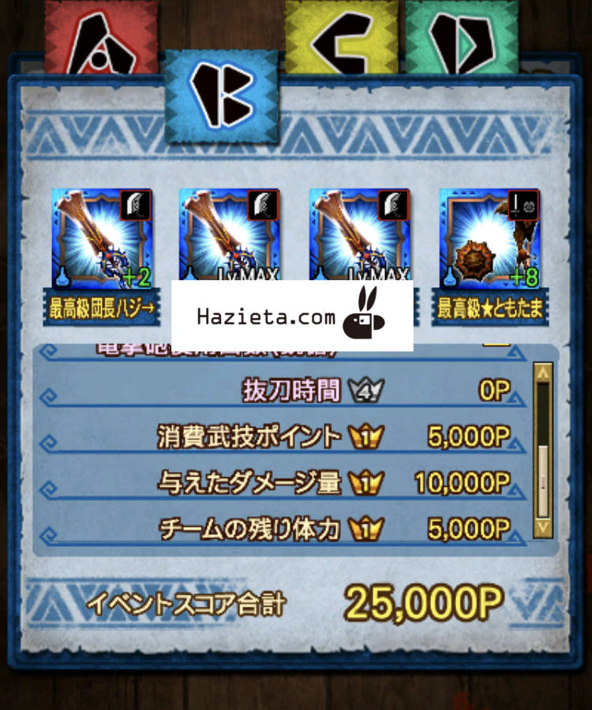

十六人衝突戦、2倍イベントの初日おつかれさまでした＼(^o^)／

「抜刀時間」ってどうやって稼ぐの？

って声が多かったのと

ポイントを稼ぐ上で重要な「１位ボーナス」について、

少し書かせていただきます＼(▽⌒*)>

## 十六人衝突戦

### 抜刀時間について

正直、私も良くわかっていません笑

負け始めるまではと、

プラーヴァとティガ片手でずっとやってたのもあり、

抜刀時間の順位はほとんどが4位でした＼(^o^)／

どうも、覇玉でない大剣や片手剣では

この部門では稼げないようです( ´ ▽ ` )ﾉ

って言っても総合は勝てちゃいます＼(▽⌒*)>

どうも、覇玉大剣のあの

タメながら移動する覇玉アクションなどは

高ポイントだという噂ですね！！

実際に、スチムロックがいるチームが

順位高いことも多かったです♪

「抜刀状態の時間」ではないようですね。

解析できたら、また追記させていただきます＼(^o^)／

### １位ボーナスについて

このボーナス、

実は私、当日まで知らなかったのですが笑

1位を取ったときに1.5倍のボーナスがつきます＼(^o^)／

さらに、そのボーナスはそのクエストのみでなく、

クエスト３回分も貰えることになっています＼(▽⌒*)>

つまり、1位を取り続けることができれば

もちろん稼げますが、

少なくとも3回に1度は1位を取って

1位ボーナスを継続させることも

重要になってきますねっ(๑˃̵ᴗ˂̵)و

さぁ、お守りとレアチケのために頑張り楽しみましょう＼(^o^)／

ちなみに、レアチケは

ゲットできる枚数を数えてみると

今イベでは最大6枚となっています＼(^o^)／

これは確率も確率なので、

何も考えず気合で当てましょう！！
