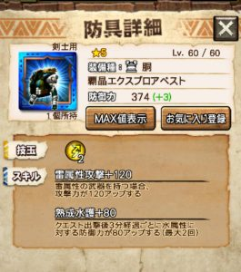
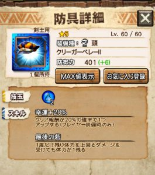
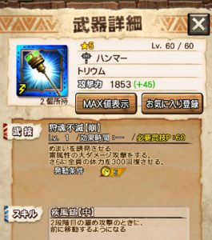
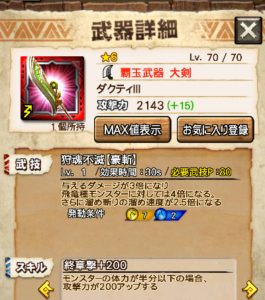
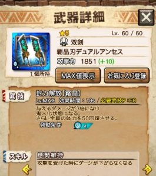
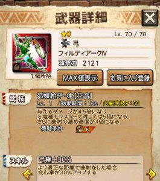
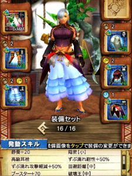

ギルチケ排出やコラボイベントが終わったのも束の間！！

次の十六人討伐戦が8/21(月)から始まりますねー＼(^o^)／

実はそこそこ詳しい情報もとっくに出ておりまして、

その内容を一つずつ見ていきたいと思います♪

まだ準備できていない方は

一緒に始めていきましょう( ´ ▽ ` )ﾉ

## 第17回十六人討伐戦

### 災凶ギギネブラ劇毒種

劇毒の十六人仕様となりますねー♪

劇毒と同様に

飛竜種

そして

水属性（雷属性が弱点）

となっております♪

津波は健在で、

劇毒種よりも広範囲とされています。

離れて避けるという選択肢はなくして良いでしょう！！

毒爆弾は、広範囲で爆発タイミングがランダムと発表されています笑

武技避けや匠の技避けを考えている人は注意！！

そして、いつも通り、開始時と怒り時は咆哮となっています～( ´ ▽ ` )ﾉ

### ギルドナイト・メイドシリーズの排出率UPイベント

確率は1.5倍の予定となっています♪

期間は

  | 日付  | 時間
  | 8/22(火)  | 17:00～24:00
  | 8/26(土)  | 17:00～24:00

の予定です♪

しかし、、、

メイド排出が始まったころからやってる人にとっては、

もうほとんどプラカンしてるし

関係のないイベントになりますね笑

新人さん新米さん救済のイベントとなります＼(^o^)／

まだプラカンできていない人、

進化できていない人は狙い目(๑˃̵ᴗ˂̵)و

というか、

来月のVer6.4の新モンスターも雷属性が弱点となります！

まだの方はこのタイミングで頑張りたいですね！！

### 素材倍率UPイベント

確率は1.5倍と2倍の予定となっています♪

期間は

  | 倍率  | 日付  | 時間
  | 2倍  | 8/21(月)  | 17:00～24:00
  | 1.5倍  | 8/27(日)  | 17:00～24:00

の予定です( ´ ▽ ` )ﾉ

大体の方は

メイドよりこちらの方が大事になってきますね！！

### 交換所ラインナップ

今回、交換可能なレア防具は、

エクスプロアの胴ですね♪

[Ver6.4で来る水モンスター](../../../mhxr/update-info/ver060400/)で有利となる属性となります！！

しかし、雷の胴は色々と優秀で

この胴はあまり使わないというのが現状。

雷属性は求められるスキルも多いんです( ´ ▽ ` )ﾉ

そして、交換可能なクリーガー防具は、

クリーガーの頭＼(^o^)／

クリーガーシリーズで唯一進化している部位となります♪

防御値が高く、砦スキル付きで、

下位ハンターで人気の防具ですね！！

幸運値も頭部位で最高値となっており、

100%にしたいときにも良く使用されます( ´ ▽ ` )ﾉ

### 武技秘伝書ラインナップ

今回は、順番通りの

アネモ
 トリウム
 ダクティ
 クリソス
 シャガルマガラシリーズ
 豪華シリーズ

となります。

シャガルということは

秘伝書クエストで手に入る系も

仲間入りしてきましたねー＼(^o^)／

ダクティやトリウムも各武器種では未だにトップクラスの性能♪

そしてテガが新モンスだった時代の武器なので

持ってる人も多いですよね～♪♪

これでまたハンターが強くなります＼(▽⌒*)>

### 事前準備

ずぶ濡れと毒の状態異常があるということは、

ラングロのときに使用していた

装備セットが必要になってきますか( ´ ▽ ` )ﾉ

まず、十六人討伐戦というのは

今の仕様では

信頼できる味方はたったの 4/16人です。

どんなチームになったとしても

負けないように準備しておくことは

とても重要になってきます( ´ ▽ ` )ﾉ

通信時間もそれだけでも長いですからね！！

よって

毒とずぶ濡れは

どちらか片方だけ対策しても

毒を食らってしまうと負け

になる可能性があることは

ラングロで経験済の方も多いでしょう。

十六人討伐戦の毒は異常にしぶといです( ´ ▽ ` )ﾉ

一度食らうとハンターが倒れるまで

身体を蝕み尽くします。

つまり、近接剣士は

たとえ防御値を犠牲にしても

ずぶ濡れと毒の耐性は100%に。

毒だけ対策しても

ずぶ濡れになるともちろんスキルは無効化されますからね( ´ ▽ ` )ﾉ

遠距離ガンナーは

ずぶ濡れのみか、両方無しでも大丈夫でしょう♪

ずぶ濡れ耐性や毒耐性は、

属性もバラバラで探すの大変なので、

今回も一覧にしておきます～♪

#### ずぶ濡れ耐性防具の一覧（耐性50%未満は除外）

  | 頭  | 星祭(※七夕イベ)、ギギ亜、
  | 胴  | ゼクス、レイスト、凶ペコ、
 シャイン、
  | 腕  | メイド、
  | 腰  |
  | 脚  | キリン、

※一応、文字色が技玉の属性となります。
 （2色は副属性）
 ※今回のお守りはずぶ濡れ耐性50%です。

 [20170821追記]
 お守りについての注意点あり
 [⇒第17回十六人討伐戦 ポイントアップのお守り](../../../mhxr/events/17times-16people-accessory/)
 [http://hazieta.com/mhxr/events/17times-16people-accessory/](../../../mhxr/events/17times-16people-accessory/)

#### 毒耐性防具の一覧（耐性50%未満は除外）

  | 頭  |  クイーン、クオイズ、
  | 胴  |  凶ガノ、紅蓮(※ストⅤコラボ)、
 シャイン、
  | 腕  |
  | 腰  |  バリアウルク、
  | 脚  |

### おすすめ武器

最後に、

おすすめ武器を載せておきます＼(^o^)／

フィル太刀は今回も置いておきましょう。

相方となるテガ片手が

毒耐性も付けれないし防御も低いし

大変そうですねー( ´ ▽ ` )ﾉ

まずは～

ハンマー♪

スタンも回復もできて、

武技もめまい効果持ちの素敵武器！

秘伝書も今回が対象となるので

強化しながら楽しめる武器となります(๑˃̵ᴗ˂̵)و

今回は火力不足が予想されるので

1スタンでは終わらないかもしれませんね～♪

それか逆に体力を減らしてくれるかもしれませんね( ´ ▽ ` )ﾉ

次に～

飛竜といえばこれ！！

エクスプロアの脚を付けながら

ずぶ濡れ耐性とブースターを確保できれば

トップクラスの破壊要員になれますね！！

第2スキルにずぶ濡れ攻撃耐性も50%付いているのです♪♪

次に～

スタンの補助と回復可能なフィルティ笛＼(^o^)／

武技時間も10sと短め。

あまりブースターは積めませんが、

演奏ゲージを早く貯めることができれば

武技数によるポイントもかなり稼げると思います。

その次に～

弱点ではありませんが、

十六人討伐戦では

ポイント稼ぎのために

武技数も大事になってきますので

前回は弱点属性でもあり、良く使用されていました(๑˃̵ᴗ˂̵)و

あとは、バリアウルクの腰とも属性が一致しており、

ブースターも積めますね！！

クリーガー双剣も同様です。

最後に～

ガンナーからも一つ♪

フィルティ弓( ´ ▽ ` )ﾉ

天漢夢幻の脚（七夕イベのガチャ）

などがあれば、

破壊王付けながら

ブースターも積めれそうですね！！

昨日まで開催していた大罪の頭もあれば

ずぶ濡れ付けてもこんな感じ♪

