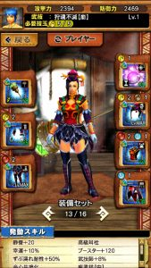
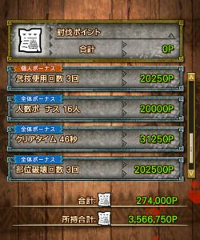
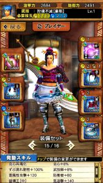
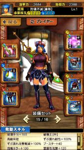

第17回十六人討伐戦の

「災凶ギギネブラ劇毒種」ですか♪

初日の2倍時間おつかれさまでしたー＼(^o^)／

一番上の難易度が強個体ってランクになるのですが、

その難易度は、

イージー。

要は楽勝でした笑

あくまで、最前線となる

1人の攻防が計5000弱くらいとなる

マッチング・レートでの話ですが、

難易度はとても低いです。

開幕でワンキルなんてこともあったり、

普通に戦ってもギギネブラのKB(ノックバック)が多すぎて

フルボッコ状態です。

もし、ハンマーや笛を担いでいると

頭をずっと攻撃していられます( ´ ▽ ` )ﾉ

正直、

サポート要員はずぶ濡れも毒も対策不要。

そして、

部位破壊やダメージを与える役目となる

火力要員はずぶ濡れだけで毒対策は不要。

です笑

毒が広範囲となるって話も微妙に広くなっただけでした。

そもそも、火力がたった2人でも居れば

劇毒は毒攻撃も何もできないでしょう( ´ ▽ ` )ﾉ

## おすすめ装備

おすすめというか

初日に私が使っていた装備を紹介させていただきます♪

トリウムハンマー♪

疾風槌付きの有能ハンマーなだけでなく、

武技でめまいも継続・蓄積でき、

おまけに体力回復300という大回復もこなす万能武器ですね！！

ブースターも上記のように140など積むことができると

30秒あれば武技3回を実行することも可能です♪

一応手順としては～

  | 手順  | 内容
  | step1  | 静養が発動する前に武技使用。
  | step2  | クールタイム中は1,2発程度のタメ2攻撃をおこなうなどし、
 クールタイム満了のタイミングにタメ3を放てるように溜めておく。
  | step3  | タメ3をスタンプまできちんとヒットさせてから2回目の武技使用。
  | step4  | step2、step3と同様の行動をすることで武技が貯まるので3回目の武技使用。

という感じで約30秒ですね！！

ハンマーが2人以上いれば、

遅くてもこの辺でスタンしているはずです♪

ポイントはこんな感じ( ´ ▽ ` )ﾉ

あとは～

人気絶頂のダクティ。

破壊王とずぶ濡れ耐性、会心共鳴をセットで付けています( ´ ▽ ` )ﾉ

あと、上の装備は胴を大罪にしても良いですね！！

そうすることで

防御も上がると思います♪

さらに、ガチャ防具が頭の戦獄だけとなりますので、

作成難易度が低いのも良い事ですねー＼(^o^)／

戦獄の頭が無くても、腰をゼクスにするだけですしね！

よって、このセットは良く見かけることになると思います～♪

そんなの嫌！自分だけのセットを使いたい(笑)

という方はこんなこともできますよ( ´ ▽ ` )ﾉ

もちろん破壊王とずぶ濡れ耐性、会心共鳴は付いています。

そして、火力の減りは抑えつつ

ブースター値が増してるので、

使っていても楽しいハズです(๑˃̵ᴗ˂̵)و

防御値は下がっていますが、

気迫の条件も無くなっていますし

ずぶ濡れ攻撃軽減が100%

になっていますからね＼(▽⌒*)>

全然気にすることはありません♪

以上です♪

スタン要員と火力要員を紹介させてもらいましたが、

どちらも2人居れば仕事を全うできますので、

2対2の4人チームが作れると勝率100%にできると思います( ´ ▽ ` )ﾉ

お守りがガンナーしかない

って人も徹甲榴弾などでスタン要員は可能ですよね！！

さて明日はメイドイベント！

また同じチームとなりました時は

何卒よろしくお願いいたします( ´ ▽ ` )ﾉ
