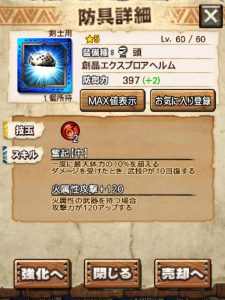
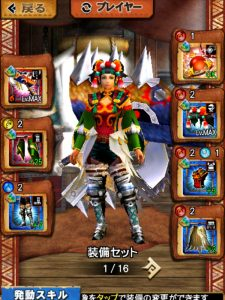

今月は、コラボイベントがなく

ギルチケ排出もまだなので、

まったりが続き、しばらく空きましたー＼(^o^)／

が、次の十六人討伐戦が9/19(火)から始まりますねー( ´ ▽ ` )ﾉ

前回は災凶ギギネブラ劇毒種の1回目でしたので、

今回も同じですね！！

簡単に見てみましょう＼(^o^)／

## 第18回十六人討伐戦

### 災凶ギギネブラ劇毒種

劇毒の十六人仕様。

劇毒と同様に

飛竜種

そして

水属性（雷属性が弱点）

ですね！！

ハンターの体力を長時間蝕む

劇毒の異常状態

も、

敵モンスが

KB（ノックバック）が多く、

体力が少ない仕様なので

ハンターが倒れる前に倒せてしまう。

そんな相手でしたね＼(▽⌒*)>

毒耐性は無しで、

ずぶ濡れ耐性ありの火力か

ずぶ濡れ耐性なしのブースターか

のどちらかで十分ですね( ´ ▽ ` )ﾉ

ずぶ濡れ耐性の防具は一覧にしておきます＼(^o^)／

#### ずぶ濡れ耐性防具の一覧（耐性50%未満は除外）

  | 頭  | 星祭(※七夕イベ)、ギギ亜、
  | 胴  | ゼクス、レイスト、凶ペコ、
  シャイン、
  | 腕  | メイド、
  | 腰  | エクスフォース 、
  | 脚  | キリン、

### ギルドナイト・メイドシリーズの排出率UPイベント

確率は1.5倍の予定となっています♪

期間は

  | 日付  | 時間
  | 9/20(水)  | 17:00～24:00
  | 9/23(土)  | 17:00～24:00

の予定です♪

### 素材倍率UPイベント

確率は2倍と1.5倍の予定となっています♪

期間は

  | 倍率  | 日付  | 時間
  | 2倍  | 9/19(火)  | 17:00～24:00
  | 1.5倍  | 9/24(日)  | 17:00～24:00

の予定です( ´ ▽ ` )ﾉ

### 交換所ラインナップ

今回、交換可能なレア防具は、

#### エクスプロアの頭

奮起は強い！！

ついこの間、進化したエクスプロア防具ですね！！

#### クリーガーの脚

貴重な土の脚♪

貴重なせいか意外と使いますよねー( ´ ▽ ` )ﾉ

### 武技秘伝書ラインナップ

今回は、

凍氷
 ライゼクス
 スチムロック
 テラジュール
 フラウボイラー

となります＼(^o^)／

あとはチケのみですが

ティグ（進化後）などの超レア
 戦獄のチャアク（進化後）などのレア

も入手可能となっています＼(^o^)／

超レアなどの進化後スキルが

対象となったのは初めてですね！！

ティグはつまりはこうなります＼(▽⌒*)>

武技P54は、また壁が低くなりますね！！

これまでは、

このようなセットにして

耳栓付けてブースター50＋武技師にして

開幕に解放突き一回分のスラゲージを貯めて武技。

などは周回装備として基本でした＼(^o^)／

獅子装備を持ってない人は、

火力を捨てて

ブースター60にしたりしましたよね♪

このハードルがかなり下がります！！

さらには、来月の新モンスは氷属性なので

弱点武器でもありますよねー( ´ ▽ ` )ﾉ

書集めやレア探し、

今回も頑張りましょー＼(^o^)／

（とりあえずは0:00からのガチャを引いてみよう♪）
