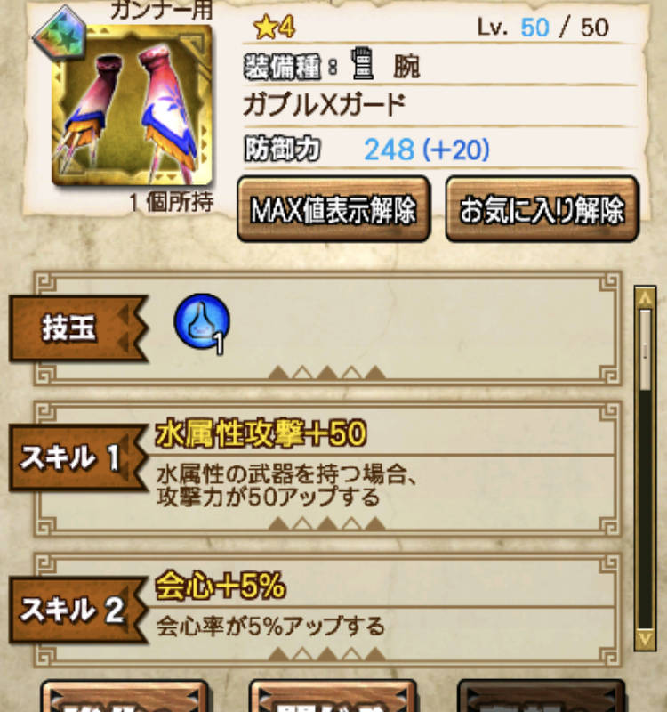
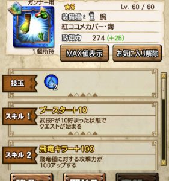

バイオハザードコラボも、明日で終了ですね＼(^o^)／

特攻武器でしか出撃できない

という仕様が中々面白く、

タイムアタックなど白熱した人も

多かったのではないでしょうか( ´ ▽ ` )ﾉ

で最終日、

イベント防具をどれを作るかで目標を用意し、

ラストスパートすることになりますよね(๑˃̵ᴗ˂̵)و

防具を一通りおさらいしておきます～♪♪

## バイトハザードHDリマスターコラボ

### 防具一覧

#### 抗蝕の頭

吸血スキルと破壊手当ですね( ´ ▽ ` )ﾉ

技玉は水2火1。

高難度クエや難しいソロクエで

根性付の弓などで

不死ゾンビ作戦に使えますね＼(^o^)／

まぁその程度なので優先度は低め。

#### 抗蝕の胴

新しめのスキル回避回復・武ですね＼(▽⌒*)>

あとは回避性能。

組み合わせは良いですが、

武器種が限られてきますね( ´ ▽ ` )ﾉ

回避回復スキルというのは、

ステップでも発動し、

武技クールタイム中でも発動します。

なので、

回避しながら華麗に戦う

双剣やライトボウガンでは

火力に繋がり、

バフなどのサポート系の武器でも

武技中に武技を回収したり

活用することはできますね！

あと、今回のイベントガンキンのように

ゾンビ化する間の待ち時間も有用な時間♪

エリア移動の待ち時間もできそうなのですが

不具合なのか10月現在は発動しませんね＼(^o^)／

#### 抗蝕の腕

覇道40と会心10%、

強すぎですね！！

これまでの腕の火力防具といえば

ハプルの腕

から始まり、

星5の時代からは水着の腕。

そして、フィルティ。

火力はこの辺だけでしたかね＼(^o^)／

まだ、武器種によってはフィルティで十分ですが、

手数の多い火力武器などを使うときのために

剣士もガンナーも

最優先で作って良い部位ですね！！

#### 抗蝕の腰

火傷耐性と開戦の狼煙ですね♪

火傷耐性は、思いつくものをあとで並べておきます＼(^o^)／

開戦スキルはさておき、

腰の火傷耐性はほぼ無いはずなので、

優先しても良さそうですね＼(^o^)／

#### 抗蝕の脚

毒耐性と超根性です( ´ ▽ ` )ﾉ

毒耐性についてもあとで表にまとめますが、

脚は無かったはず、、ですよね( ´ ▽ ` )ﾉ？

ただ、この防具とスキルが被ってるので注意！！

### 関連スキル一覧

#### 毒耐性防具の一覧（耐性50%未満は除外）

  | 頭  |  クイーン、クオイズ、
  | 胴  |  双チャナ、凶ガノ、ボルトシャイン、
 紅蓮(※ストⅤコラボ)、
  | 腕  |
  | 腰  |  ブレイブ、バリアウルク、
  | 脚  |  抗蝕(※本コラボ)、

#### 火傷耐性防具の一覧（耐性50%未満は除外）

  | 頭  |  炸裂ブラキ、アクアシャイン、
 CEケブラー(※FATEコラボ)、
  | 胴  |  双ギギ、マリン、タマミツネ、
 メリオダス(※七つの大罪コラボ) 、
  | 腕  |  烈水、ジョー、
  | 腰  |  ナルガ、抗蝕(※本コラボ)、
  | 脚  |  紅蓮(※ストⅤコラボ)、ガノ、
 アルゴー、
