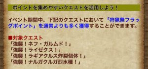
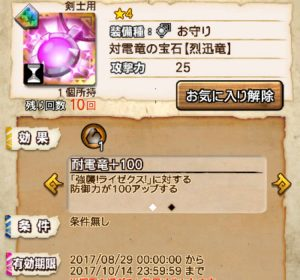
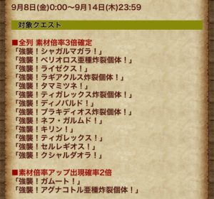
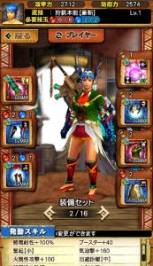
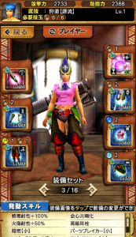

明日の2017/09/08は、

２周年記念狩猟カーニバルの最終日ですねー♪

今回は全体累計ポイントの報酬もあり、

個人ポイントで交換したアイテムが

二倍となる報酬もすでに確定していますね！！

交換がまだ終わっていない人も

やれるところまで頑張りましょう(๑˃̵ᴗ˂̵)و

、、ということで今回も、

フラッグの効率的な集め方を

明日の最終日のために少し紹介させていただきます～♪

## 狩猟祭フラッグＰの稼ぎ方

### 獲得ポイントUPのイベント

今回、カーニバル中の新しいイベントがあります♪

通常よりも多く獲得できます＼(^o^)／

どれくらい増えているのかまでは気にしてませんでしたが笑

かなり増えていそうです！！

団のメンバさんで、

とっくに交換所コンプした人がいるくらい＼(^o^)／

最終日の明日も

ネフとライゼクスと炸裂ラギア

はスケジュールに入っています( ´ ▽ ` )ﾉ

### 対雷竜のお守り

最終日のスケジュールの中でおすすめしたいのが！！

ライゼクスです＼(^o^)／

9月のマンスリークエストとして

「7日間ログインする」をクリアしただけでもらえるお守りです♪

第2スキルは攻撃力100アップとなっており、

当時、ライゼクスと戦っていた人なら

サクサク周回できそうですねー＼(^o^)／

### 素材倍率全列3倍イベント

そして夕方に来た追加イベント♪

素材倍率って良く来るイベントだと思いますが

「全列」というイベントはアツいです！！

基本報酬の一列目も倍率かかるのです＼(^o^)／

要するに、

タダで貰ったお守りで

剣士10回ガンナー10回をとりあえず行けば、

ざっと150万くらい稼げるんではないかと(๑˃̵ᴗ˂̵)و

私も準備してみます♪

剣士は進化ほやほやのレア大剣＼(^o^)／

私は今までナベイルを持っていませんでしたので、

ダクティで戦っておりました＼(▽⌒*)>

今はやっぱり、こっちが使いたいですねー♪

耳栓つかなかったのが心残り＼(^o^)／

ガンナーも進化ほやほや蒸気ヘビィ。

ライゼクス実装の当時から

水面下で人気のあった武器ですね！！

進化して回復力が2倍以上となった

その実力を見せてもらいましょう＼(^o^)／

『ラストスパート稼ぐどー＼(▽⌒*)>』
