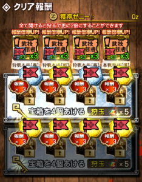

本日から狩猟祭カーニバルですね( ´ ▽ ` )ﾉ

狩猟団で協力して集めた「狩猟団累計報酬」はもちろん♪

個人で獲得したポイントにより、

貴重なレア玉や進化素材と交換できるので

普段よりも積極的に狩りたくなりますよね＼(^o^)／

そこで今回、フラッグの集め方、

つまりは狩猟祭フラッグポイントの稼ぎ方を紹介させていただきます～♪♪

特に今回は、

カーニバルの期間と

秘伝書クエストが久しぶりに被っています♪

これはチャンスなのです！！

以前に一度被ったときに

私も荒稼ぎしました＼(^o^)／

そのときは途中から

不具合なのか稼ぎすぎな人へのストッパーなのか

フラッグが排出されなくなりましたけど笑

これ、意外と知らない人が多いみたいですね～♪

## 狩猟祭フラッグポイントの効率的な稼ぎ方

その一つは、

上でも書きました通り「秘伝書クエスト」です！！

まだ武技がレベルマになっていない

秘伝書クエストがある方は一石二鳥ですね♪

このように、秘伝書クエストは一段目にも

一律の倍率がかかります( ´ ▽ ` )ﾉ

エクスプロア武器以外はランダムで×1～×4の倍率。

見ての通り、フラッグもその倍率となります＼(^o^)／

。。以上です笑

あと、狩猟祭フラッグポイントが

「2倍のときとそうでないときがある」

って質問を受けたことがあります。

それは「ビンゴミッションの報酬アップ率」です＼(▽⌒*)>

常に100%の人は気にしなくて大丈夫ですねー♪

そうでない方はお気をつけて！！

## 秘伝書クエストのスケジュール

ちなみに、カーニバル中の秘伝書クエストは以下となります～( ´ ▽ ` )ﾉ

  | 日時  | 秘伝書クエストなど
  | 8/4(金)  | エクスプロア武器
  | 8/5(土)  | ディノバルド武器
 （炸裂アグ亜の初日）
  | 8/6(日)  | シャガルマガラ武器
  | 8/7(月)  | ライゼクス武器
 （最前線ボーナスクエスト1日目）

 。。こう見ると、中々忙しくなりますね～笑

私は、この時のために秘伝書クエストの周回は

ほどほどにしてきました＼(^o^)／←

（プラカンやレベルマになって、報酬の意味がなくなってくると
 変に消極的になってしまうタイプなのですー。）

今回のカーニバル！皆さん一緒に楽しみましょう＼(^o^)／
