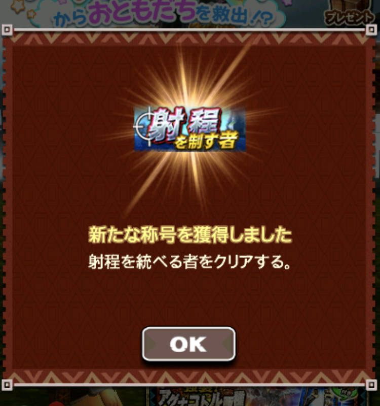

生放送始まりましたねー＼(^o^)／

予定あって見れないのが残念。。

そして、今日の「先行配信」になるのかな？

高難度クエストについて、

称号は貰えない仕様となっていましたが

貰えましたので

取り急ぎ書かせていただきます＼(▽⌒*)>

## 高難度クエスト「射程を統べる者」

凶暴ディ亜、鋼膜レギオス、ラギア希少ですね＼(^o^)／

うちはルヴァンライト、メルザ、エビ、アル弓で行きました＼(▽⌒*)>

私はアル弓で、

クリア後も何十回か行きました、

乙る気はしませんでしたねー＼(^o^)／

適正スキルがあれば、

あとはガンナーに慣れてるかどうかくらいかと！！

で、

称号貰えてびっくり！！

金銀のときも先行配信で取得できましたが、

もっと時間短かったのでゲットしてる人少なかったですよねー＼(^o^)／

この仕様は私は賛成ですｗｗ
