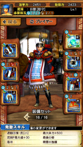
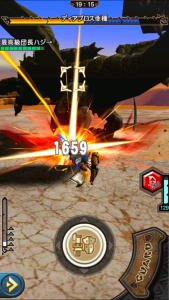
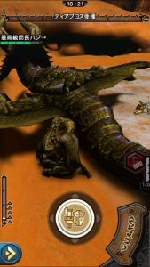
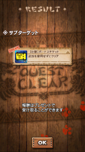
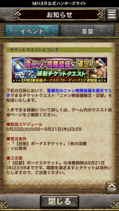

ガムートと炸裂アグナコトル亜種の装備のみで挑む、

その名の通りの最前線クエストですね＼(^o^)／

そのクエストにさっそく挑んできましたので♪

その実績ある1つのクリア方法を書いておきますねー♪

今回は、サブターゲットがありまして、

「武技を使用せずにクリア」も達成しないとですね！！

## 最前線クエスト（ガンス編）

正直、強化さえできれば

なんでも勝てると思います♪

私はとりあえず、この装備で行きましたねー＼(^o^)／

使いたい装備だけ強化したこのセットです笑

手順は簡単でした♪

追加装填し切って竜撃砲。でこの状態

（レベル60なら、2ゲージ減りましたね。）

で再び追加装填しながら

急冷スキルの恩恵も受けながら竜撃砲の冷却待ち。

で竜撃砲2発目で終わり。

チケットの出方は想像どおりですね( ´ ▽ ` )ﾉ

このチケと幸運50%おまの受け取りは

プレゼントボックスから♪

ちなみに！

[星6レアハンマー（砕塊豪鎚）](../../../mhxr/weapon/6stars-rare-hammer-ability/)では出撃できませんでした笑

（少し期待していました←）

あと、今回手に入れたチケットは

すぐには使用できませんのでお気をつけて！

8/22以降となります♪

このイベントは以上です♪

ガンランスはもう少しレベル低くても

「竜擊砲2発終了」できそうですね！！

情報入りましたら追記しますねー♪
