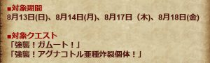
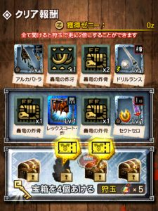
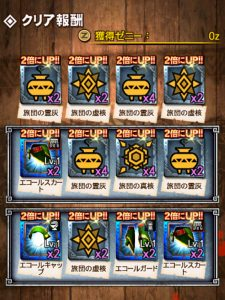

2017年8月のギルド討伐依頼クエストが

早くも開催されますねー！！

今月はガムートと炸裂アグ亜＼(^o^)／

炸裂アグ亜に関しては以下の周回方法

[⇒炸裂アグナコトル亜種 最速周回](../../../mhxr/monster/agnaktor-sub-expl-repeat-combi-fast/)
 [http://hazieta.com/mhxr/monster/agnaktor-sub-expl-repeat-combi-fast/](../../../mhxr/monster/agnaktor-sub-expl-repeat-combi-fast/)

で問題ないと思いますが、

ガムートの周回はまだ記事にできていません笑

いつもより早い開催で正直、油断していましたー＼(^o^)／

画像などの素材を探してみて

もしあれば記事にさせていただきます～♪

ホーク エコールの進化情報や強化素材は[こちら](../../../mhxr/armor/hawk-ecole-lvup/)をどうぞです( ´ ▽ ` )ﾉ

## ギルチケ排出のスケジュール

ギルチケ（ギルド討伐依頼チケット）が

排出される時間はいつものように決まっておりまして

の4日間ですね＼(^o^)／

開催されるクエストは以下の通り♪

  | 8/13  | 炸裂アグ亜
  | 8/14  | ガムート、炸裂アグ亜（笑）
  | 8/17  | ガムート
  | 8/18  | 炸裂アグ亜

14日がまた。。。笑

皆勤する方は、

18:00から6時間コースとなるアレですね＼(^o^)／

## ギルチケの排出のされ方

ギルチケは毎月4枚だけ配布され、

あとは対象クエストで

ランダム排出されるものを集めることになってきます♪

排出のされ方として

残ってたのが昔の画像（炸裂ティガの時みたいですね）

になりますが、

のように報酬画面で

開ける前から吹き出しでわかるようになっています♪

欲しい枚数を確認して、

任意に開けていくことになりますね＼(^o^)／

画像のように×2や×3、×4の倍率UPも重なります♪

さらにはマシマシ宝まんや、

三列全て開けたあとのお宝2倍も重なります！！

よって全て重なれば

たった1回の出撃で

ギルチケ30枚以上

を手に入れるなんてことも有り得るのです＼(^o^)／

そんな大チャンスを狙うために、

開ける回数よりも

クエスト回数がとても大事になってきますねー( ´ ▽ ` )ﾉ

しっかり準備していきましょー！！

## ホーク エコール装備の入手

ギルチケを入手した後は、

ギルチケ4枚を消費することで

ギルド討伐依頼クエストに1度出発することができます( ´ ▽ ` )ﾉ

そしてそのクエストのクリア報酬で

ホーク エコールの防具がランダム排出されることとなります～♪

このように＼(▽⌒*)>

強化素材も

ここでしか手に入らないアイテムとなっています♪

自分はどの素材が不足しているのか

それを知ってから挑むのも大事ですね( ´ ▽ ` )ﾉ

ちなみに私は「旅団の燐隕塊」が著しく不足しています笑

いわゆるわかめですね( ´ ▽ ` )ﾉ

必要な素材については以下にまとめてありますので～♪

[⇒ホーク エコール装備（防具）の強化素材](../../../mhxr/armor/hawk-ecole-lvup/)

[http://hazieta.com/mhxr/armor/hawk-ecole-lvup/](../../../mhxr/armor/hawk-ecole-lvup/)
