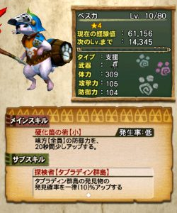
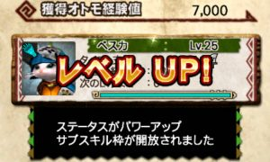
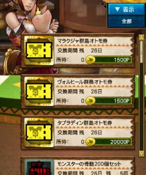
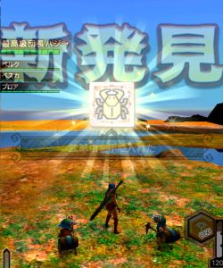

発見物探しの心強い相棒！

オトモアイルーのペスカが

早くも実装されていますね＼(^o^)／

ペスカを相棒として連れて行くだけで

発見物はすぐに見つかります♪

タブラディン群島が

実装され始めた頃からプレイされている方は

良く知っていると思いますが、

ペスカの活用方法も紹介させていただきます＼(^o^)／

### 発見物の発見確率UPのサブスキル

発見物の発見確率をUPする

というオトモアイルーのサブスキルは、

10%などという

とんでもなく高い効果値となっています＼(^o^)／

本来の確率が10%以下

の珍しい発見物もありますので、

このスキルがあるだけで

要する時間が大きく変わります＼(▽⌒*)>

### ペスカ活用術

10%でも十分なのですが、

このサブスキルは

「重複不可」の文がありませんので

重複できると考えられています＼(^o^)／

体感としても30%にすると

2～4回で見つかりますので

反映されているように思えます( ´ ▽ ` )ﾉ

そのやり方は～♪

まずペスカをLv25にします( ´ ▽ ` )ﾉ

Ver6.4のアプデで歴代のクエストなどの

ソロクエも増えたところですので、

レベルはなんなく上げれると思います＼(▽⌒*)>

するとこのように、

サブスキル枠が開放されますので

二つ目のサブスキルを覚える準備ができました♪

そして

「タブラディン群島オトモ券」を交易店でゲットし、

サブスキルを覚えさせたいオトモアイルー2匹

ペスカともう一匹をオトモに設定し、

チケットクエストをクリアすることで覚えます＼(^o^)／

このチケットクエストは

チケット1枚で2匹とも覚えることができますので、

10％が2匹で20%上乗せできる（と考えられています笑）

私は、プロアにも覚えさせました( ´ ▽ ` )ﾉ

この相棒たちで行ってみますと

一発目で出ました～～＼(^o^)／

