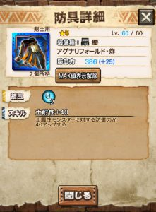

8/5に狩猟解禁のアグナコトル亜種（炸裂個体）、

そのクエストで入手可能な装備の性能やおすすめを

一つ一つ紹介したいと思います＼(^o^)／

そして、最前線用の装備がこれにて出揃いましたので、

ガムートとの対比表も簡単に作らせてもらいますね(๑˃̵ᴗ˂̵)و

炸裂アグ亜装備の注目部位は「頭」ですか＼(^o^)／

#### アグナUヘルム・炸（頭）

新しいスキル、「連動回復・武」ですね( ´ ▽ ` )ﾉ

武技時間やクールタイムの短めな武技や

武技中に攻撃しないようなサボート系の武技で

活躍できますね！！

技玉は「和奏シリーズの頭」と同じ。

#### アグナUメイル・炸（胴）

氷胴の超根性。

これはガンナーで考えると貴重ですね♪

氷のガンナー武器は優秀です＼(^o^)／

普段の装備に組み合わせるとぴったりな方も多いはず！！

#### アグナUアーム・炸（腕）

武体還元ww

自分だけが回復するメリットは非常に少ない。

武体還元スキルは私、

やり始めた当初、HR1で既に不要だった。

そんなスキルです( ´ ▽ ` )ﾉ

このスキルの主な使い道は、

根性からの復帰や、気迫擊や気迫護のために存在します。

開幕400食らう、みたいなクエストが現れたら

気迫擊のために使用を検討します笑

#### アグナUフォールド・炸（腰）

ホーク エコールの完全な下位防具。

間に合わせにご利用ください。

#### アグナUグリーヴ・炸（脚）

予告通りの最大体力スキルですね( ´ ▽ ` )ﾉ

技玉はマグナソルナの脚と同じ。

最大体力については

[ガムートのとき](../../../mhxr/monster/hellblade-glavenus-equip-ability/)と同じ評価になりますが、

今はあまり使い道がありません。

主に気迫擊や気迫護のために存在します( ´ ▽ ` )ﾉ

## ガムート×炸裂アグ亜のスキル対比表

  |    | ガムート  | 炸裂アグ亜
  | 頭  | 防衛者80  |  連動回復・武小
  | 胴  | 最大体力300  |  超根性
  | 腕  | 武技P最大30  |  武体還元中
  | 腰  | 最後の砦  |  土耐性40
  | 脚  | 精霊の加護  |  最大体力200

私は、

  | ガムート  | 胴 腕 腰
  | 炸裂アグ亜  | 頭 脚

の体力がそのうちの武技に影響してくると予想しての

体力推しと技玉重視で行きます(๑˃̵ᴗ˂̵)و
