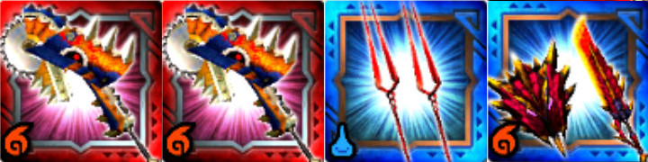
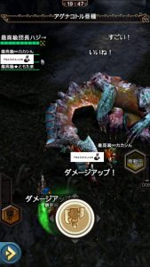
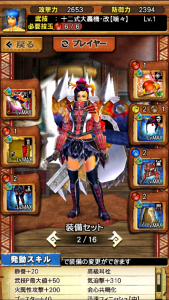
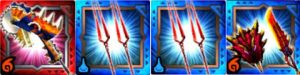

炸裂アグナコトル亜種は、

1:00の部でスタンなしで倒せる計算ができています。

と話してましたが、

ほんとに倒せました笑

## ワンキル（ワンパン）編成

①ティグゼーゲ

②ティグゼーゲ

③ロンギヌスの槍

④豪炎斧ボルカクライム

## ワンキル（ワンパン）手順

ティグはまっすぐ近づいて

武器出し攻撃を当て、

ぶんまわしを2ヒットさせて武技が最速ですね♪

なので周回速度は最速13秒になってきますー！！

※画像はたぶん円2の構成です( ´ ▽ ` )ﾉ

ティグ装備は私はこんな感じでした＼(^o^)／

必要スキルとしては

耳栓と

ブースターは手順の通りに3ヒットでやるなら

ブースター60か、ブースター50プラス武技師が必要ですね！

炸裂アグ亜の体力は 約450万 なので

大体、属性値プラス400くらい盛れたら十分だと思います♪

この体力なので、

ティグが一人しか集まらなかった

という場合はもちろんこちらでも倒せます( ´ ▽ ` )ﾉ

①ティグゼーゲ

②ロンギヌスの槍

③ロンギヌスの槍

④豪炎斧ボルカクライム

こちらはティグのスラッシュゲージを

マックスになるまで回収する時間を稼ぐ編成となります♪

ティグは同じくまっすぐ近づいて

スラゲージをマックスにして武技。

そして属性解放突きを2回ですねー！！

ロンギも一人しか居ないって場合は、

ロンギの代わりに落とし穴の片手剣でも大丈夫ですね♪

ティグの火力が足らないって場合は、

エクエス片手にしたり♪

上のティグくらい火力積めると

円2でも大丈夫です(๑˃̵ᴗ˂̵)و

今回、体力に修正が入らない限りは

かなり高速で稼げそうですねーー＼(^o^)／
