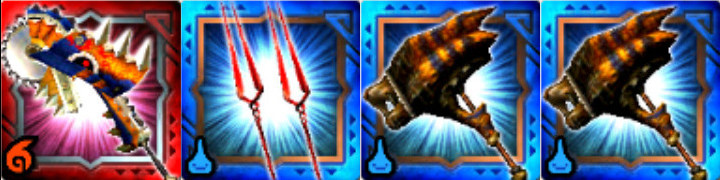

アグナコトル亜種 炸裂個体が

狩猟解禁されましたね♪

皆さん初見の狩りは、

いかがでしたでしょうか＼(^o^)／

とりあえず、

直前にアップさせてもらった

[炸裂ティガ版のワンキル（ワンパン）記事](../../../mhxr/monster/tigrex-expl-best-repeat-combi/)の通り

火力は減らしても倒せますね！！

## ワンキル（ワンパン）編成

①ティグゼーゲ

②ロンギヌスの槍

③ストライプストライク（ティガハンマー）

④ストライプストライク（ティガハンマー）

手順は[炸裂ティガの時](../../../mhxr/monster/tigrex-expl-best-repeat-combi/)と同じように、

開幕にロンギの武技「さぁ、約束の時だ」で拘束して、

その間にテガハンでスタンさせ、

あとはいわゆる乱打ティグで

属性解放突きを火力盛りなら3回当てなくても

2回で倒せます！！

火力不足なら3回当てましょう＼(^o^)／

（[属性解放突きを3回当てる方法](../../../mhxr/weapon/krieger-switch-axe-ability/)を参照）

 あとは、拘束持ちが一人だったので試せませんでしたが、

ロンギ、ロンギ、ティグ、円なんかでも倒せる計算をしています♪

試せる機会があったらまた＼(^o^)／

[20170805追記]
 さっそくですが、ロンギでスタン無しで倒せました笑（[次記事](../../../mhxr/monster/agnaktor-sub-expl-repeat-combi-fast/)を参照）
