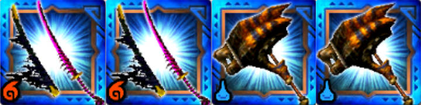
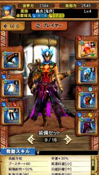
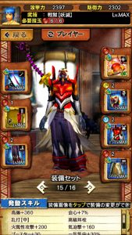

ブラキディオス爆氷種の配信も始まりましたが、

爆氷種、普通に戦うと面白いですね！！

私もまだ氷柱の位置とか解っていなくて

たまに食らったりします( ´ ▽ ` )ﾉ

そして配信前から

落とし穴どーん

で良いっしょ！と噂されていましたが、

私は、いわゆる「開幕落とし穴」

これが苦手です笑

落とし穴にハマるまでの待ち時間が

どうしていいのか暇で仕方ないのです＼(^o^)／

たぶん、私の性格だと、

作業に感じてすぐ飽きると思いますね～( ´ ▽ ` )ﾉ

レギオスもタマミツネも

初級ハンターさんのお手伝いでしか

やってきませんでした＼(▽⌒*)>

でも罠作業にスピード負けしない周回を考えてきてまして、

今回の爆氷も「罠なしの高速討伐」を事前に考えています(๑˃̵ᴗ˂̵)و

それを一つ紹介させていただきます～＼(^o^)／

## ブラキディオス爆氷種の高速討伐（罠なし）

### チーム編成

①ティガハンマー
 ②ティガハンマー
 ③戦獄の太刀
 ④戦獄の太刀

もちろん、戦獄の太刀の代わりは

ティグ（クリーガースラ）でも大丈夫です♪

スキルとしては、

ハンマーは耳栓とブースターは必要ですが、

迅脚も高速回避も不要。

太刀はブースター30は必要で

あとは乱打と火力盛り、

ですね( ´ ▽ ` )ﾉ

私はこんな感じの装備を用意してました＼(▽⌒*)>

### 討伐方法

  | 手順  |  内容
  | STEP1  | テガハンがタメ2を2ヒットさせる。
 (爆氷の開幕は、氷を張ったあとバタバタしてるので間に合います)
 戦獄太刀は気刃ゲージを黄まで回収しておく。
  | STEP2  | STEP1でスタンするので、スタンしているところに
 戦獄太刀は気刃ゲージを赤まで回収し武技する。
  | STEP3  | 戦獄太刀の武技に合わせて、テガハンも武技を合わせて終了。

編成がテガハン2なので

ゲストハンマーは少し慣れが必要かもしれませんね！！

あと、氷で滑るので回り込みは挟まないことがコツです♪

ハンマー視点の動画はこちら( ´ ▽ ` )ﾉ

▼動画「ティガハン2で開幕スタン方法（爆氷種）」【再生時間 : 約20秒】

そして、成功のイメージがこんな感じ( ´ ▽ ` )ﾉ
 ※少しパソコンが重くて音ずれています笑

▼動画「爆氷種、33秒討伐」【再生時間 : 約90秒】

ついでに、もしハンマーが失敗したときの

アフターフォロー版( ´ ▽ ` )ﾉ

一応ティグ版でもあります＼(^o^)／

▼動画「爆氷種、開幕スタン失敗時」【再生時間 : 約70秒】
