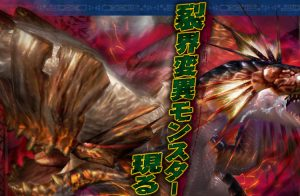

モンハンエクスプロア（MHXR）で、

まだ聞き慣れないかも知れませんが

「裂界変異モンスター」と

呼ばれているモンスターの

種類と特徴などについて

紹介させていただきます＼(^o^)／

「隠密」スキルと

新武技「忍び」についても

少し触れるつもりです♪

## 裂界変異モンスターについて

### ▼裂界変異モンスターとは？

エクスプロアのソロクエスト（島クエスト）の舞台、
 正確には断裂群島と呼ばれる場所だが、
 その群島を取り巻く「裂界域」の
 過酷な環境下で変異したと推測されているモンスター。

という設定です( ´ ▽ ` )ﾉ

凶暴個体から始まり、

鋼膜個体、炸裂個体がまとめて

「裂界変異モンスター」と呼称されています。

### ▼裂界変異モンスターの特徴

裂界変異モンスターには特殊なモードや攻撃があり、

たとえば

凶暴個体であれば、
 凶暴化状態という攻撃特化モードがあったり、

鋼膜個体であれば、
 鋼膜というオーラを纏い、鉄壁の防御モード、

炸裂個体であれば、
 時限式の爆弾を一定間隔で生成し身につけるなど、、

もうそれぞれ何種類も実装されていますので

これらの目に見える仕様は

皆さん良くご存知のことだと思います＼(^o^)／

しかし、ここから紹介する仕様は

理解できていない人がまだ多いので、

説明させていただきます( ´ ▽ ` )ﾉ

#### 裂界変異モンスターは隠密を無効化する

このことはきちんと知っておかないといけませんね！！

ギギネブラ凶暴個体のときに、
 特攻武器の弓で戦いにいったら狙われ続けた。。

この辺でこの仕様に気づいた人も多いと思います！

裂界変異モンスターは隠密スキルの効果を無効化してきます。

過酷な環境下で生息していたので感知に優れている。

みたいな設定のようです( ´ ▽ ` )ﾉ

Ver6.4で新しく追加される武技の効果

「忍び」

はこの裂界変異モンスターからも

ヘイト値（ねらわれやすさ）を減らすことができます。

まだ実装前ですが、

ガンナーが盛り上がりそうで楽しみですね！！

#### 凶暴個体には怒りモードが無い

凶暴個体は

通常状態、凶暴状態、超凶暴状態

と最大3段階までの状態変化がありますが、

通常のモンスターにある「怒り状態」がありません。

どういうことかと言いますと、

挑戦者スキル（怒り状態のモンスターへ攻撃力UP）
 や
 武技（与えるダメージが、怒り状態のモンスターに対しては〇倍）

といった効果が対象外となるのです＼(^o^)／

火力に関することなのできちんと理解しておきたいですね！！
