8/1に狩猟解禁の「ガムート」、

そのクエストで入手可能な装備の性能やおすすめを

一つ一つ紹介したいと思います＼(^o^)／

ガンスと腕に注目です！！(๑˃̵ᴗ˂̵)و

## ガムート防具

#### 頭（ガムートヘルム）

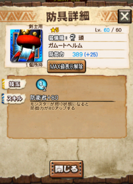

氷の技玉2は嬉しいですね！！

1年前は1種類しかありませんでした( ´ ▽ ` )ﾉ 懐かしい。

防衛80は値としてはかなり高いです！

最近、良く乙ると思う方はぜひ！

モンスターにより怒りのタイミングや

攻撃力上昇率は異なりますので無駄にならないように注意。

#### 胴（ガムートメイル）

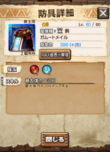

今は使い道のあまりない最大体力スキルですね！

主に気迫擊や気迫護のために存在します。

技玉が珍しい組み合わせとなっているので

覚えておいて損はない！

#### 腕（ガムートアーム）

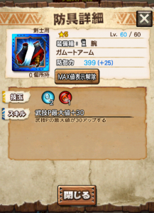

これが今回の目玉商品♪

月陽アルロバロミスとの相性が抜群ですね！！

猟虫のレベルを上げながら、武技も温存し、

猟虫のレベルが十分になったら連続武技＼(^o^)／

なんて使い方ができますね♪

フィルティ胴と組み合わせると驚異の最大武技P200くらいにww

#### 腰（ガムートフォールド）

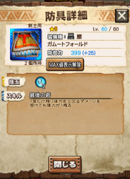

氷の腰は悩む人も多いはずです♪

また悩まさられそうですねー笑笑

あとはアグ亜炸裂の腰と

ホーク エコールの進化情報（腰が進化するか否かは未公表）が

言うてる間にありますので、

そこまでどれを愛用するか悩んでも良いですね♪♪

#### 脚（ガムートグリーヴ）

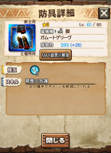

まさかの加護でしたね( ´ ▽ ` )ﾉ

ルナルガの足が倉庫行きとなりました。

これも頭と同様で「最近、敵が強くて大変！」という方に！！

## ガムート武器

#### 片手剣（巨獣剣）

最近、サポート枠で注目されている片手剣( ´ ▽ ` )ﾉ

これは面白い性能ですね♪

この匠の技というスキルが強くて、

例えば、劇毒なら

津波のようなずぶ濡れ攻撃はもちろん、

尻尾から出す毒攻撃なんかも咄嗟に避けれたりします♪

長期戦に使用するか

奮起を付けて受けたい攻撃を選ぶなんてこともできますね♪♪

#### 双剣（巨獣双剣）

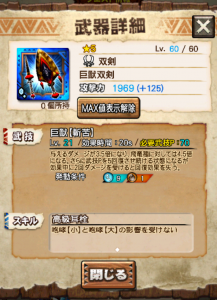

武器に耳栓が付いているのは、

火力盛りにも繋がるのでスキルは高評価ですね！！

特に氷の耳栓防具は組み込むのが難しい。

必要な技玉が多く、

鬼人化関連のスキルも武技もないので

使用難易度は高め。

防具は、回避性能をベースに組みたいですね♪

レア腰などが相性良し(๑˃̵ᴗ˂̵)و

#### 太刀（巨獣刀）

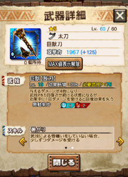

スキル1は幸運10%です。

双剣と同様で、回避性能の防具をベースに組みたいところ♪

ダスク胴や蒸し脚（蒸鉄卿の脚）を所有してるかが鍵。

必要な技玉も多め。

#### 大剣（巨獣大剣）

ティガノアギトのような使い方のできる武器♪

タメ時間短縮などがないため、

相手を選びますが、

必要技玉は少ない上に

会心共鳴防具との相性もバッチリ！！

新しいスキル「高熱化部位ハント」も

最大までタメ切ってなんぼの大剣に

タメ途中でもタメ無しでも良いんです的な

選択肢を増やしてくれる良スキル♪

でも基本的には、炸裂ベリへのスパイラルコース用の武器。

Ver6.4からは難易度が一段階上がるので、

今回は、後ほども現れますが

シャガルや炸裂ベリ亜へ戻れるルートが用意されています♪

#### 狩猟笛（巨獣弦琴）

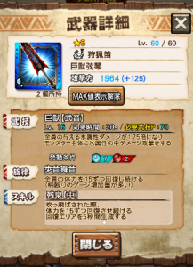

氷はバフ（狩人）が苦手な属性です。

クリスマスの槍やフィル茶（フィルティチャアク）がないと

凶ギギの笛などになってしまいますよね。。

そんな方は、、回復力や武技の効果時間により

使い分けができる武器となります！

#### ハンマー（巨獣鎚）

溜め速度3倍は驚異的な早さです！！

今まで実現できなかったタイミングで

スタンさせることができる可能性を秘めています♪

積極的に試していきたい武器だと思います＼(^o^)／

#### スポンサードリンク

#### ランス（巨獣槍）

カウンター職人が好きな方用♪

性能の割に必要な技玉が多い。

#### ガンランス（巨獣銃槍）

バランスが良すぎます笑

多エリアのクエストでも活躍しますね！！

ただ、適正防具がやや難易度高めです。

マグナソルナの腕や、

マグナソルナの頭orホーク エコールの腰があると輝いてきます♪

個人的には、これを担いでバリアナル亜に行きたいと思っています笑

（あいつだけはどうしても1人でワンキルできなくて。。）

#### スラッシュアックス（巨獣剣斧）

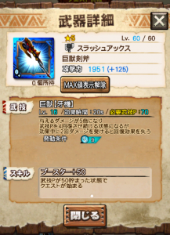

迅速フィニッシュが出回り過ぎて

使用者が減ってきているスラアク。

性能は高め。

ライオス脚と相性が良いので

スラアク離れ気味な方はぜひお試し下さい。

#### チャージアックス（巨獣盾斧）

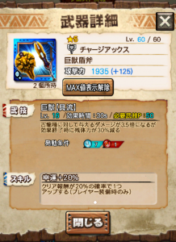

。。これがシャガル用・・・？！

私には、幸運100%に到達していない人用にしか

見えません( ´ ▽ ` )ﾉ

#### ライトボウガン（巨獣弩）

無条件の1.5倍バフ（狩人）で種族限定の2倍バフ。

回復力もあるので、バフ要因で安定さも求めたい場合などに。

#### ヘビィボウガン（巨獣砲）

すぐに再発動可能な一閃♪

マグナソルナの腕などの

会心共鳴を考える人もいるかもしれませんが

それだけでは火力不足です！！

会心強化などのスキルが実装されると

化けるかもしれませんね。

エクスプロアには、

武技うち武技ためという技もありますので

その練習には良いかもしれませんねー＼(^o^)／

あとは、一閃で楽に倒したいけど

部位破壊できない時の試用版にはなりますか♪

#### 弓（巨獣弓）

炸裂に対して有効なスキルと武技を持つ。

炸裂ベリ亜へのスパイラルコース用♪

#### 操虫棍（巨獣棍）

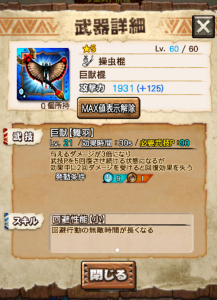

回避性能が付いていますが

その分必要技玉が多め。

これはプレイヤースキルだけではなくモンスも選びます。

[レア枠] ハンマー（砕塊豪鎚）

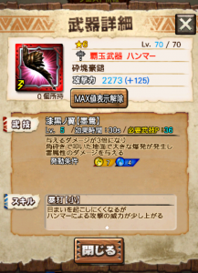

必要技玉は大量。

必要武技Pも効果時間もちょうどよく。

[チェリルのような使い方](../../../mhxr/weapon/cheriru-vs-hellblade-glavenus/)ができる＼(^o^)／

チェリルない方にはぜひとも

その右手に舞い降りてもらいたい✩

チェリル持ちは雷覇玉ハンマーとして♪

スーパーアーマー無い点は痛いですね( ´ ▽ ` )ﾉ

[[20170801追記] こちら、さっそくゲットしました笑（リンク有）](../../../mhxr/weapon/6stars-rare-hammer-ability/)
