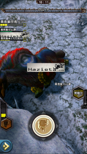
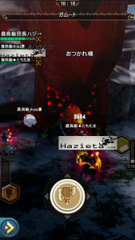

ガムート、0:00から狩猟解禁されましたね！！

簡単に、実際のプレイで確認できた情報を書いておきます～♪

## ガムートの特徴

体力 : 約720万

罠 : 有効（初回は約12秒）

拘束 : 有効

スタン : 有効（初回は約15秒）（弱点となる鼻は比較的攻撃しやすい状態）

肉質 : ※以下、大体こんな感じでした。（怒り後も同様）

 ・後脚 : 1.00（基準）（左右同じ）
 ・前脚 : 1.10（左右同じ）
 ・胴 : 1.05
 ・頭 : 1.20
 ・鼻 : 1.30

そして、初見から数回行ったのは

個人プレイで回復なしのゴリ押しチームww

体力はあるけど好き勝手に戦っても時間はかからなさそうですね＼(^o^)／

あと、覇玉ランスは耳栓外して、

開幕の咆哮に強ガードできますよー♪（←これとても大事）

あ、それと

チケットは皆さんのイメージ通り、こんな感じで出ます♪
