9/1に狩猟解禁の「ナルガクルガ烈水種」

そのクエストで入手可能な装備の武技やスキルを

一つ一つ見ていきたいと思います＼(^o^)／

## 烈水装備一覧

### ▼烈水防具

#### 烈水の頭

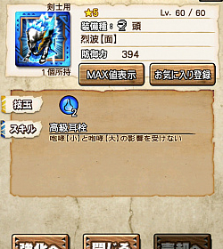

水頭の耳栓ですね♪

これで水としては

腕部位以外は耳栓確保できますか( ´ ▽ ` )ﾉ

#### 烈水の胴

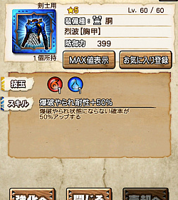

爆破やられ耐性ですね！！

たぶんこれで100%が可能に＼(^o^)／

あと50%はガノトトスの脚でしたか( ´ ▽ ` )ﾉ

#### 烈水の腕

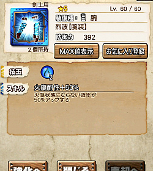

腕の火傷耐性♪

ジョー腕の上位防具ですね( ´ ▽ ` )ﾉ

技玉数も増えて防御ももちろんUPで。

#### 烈水の腰

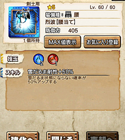

雪だるま耐性も＼(^o^)／

10月の新モンスが氷属性とのことですので！

ガムートでは不要でしたが

次はわかりませんね！！

技玉も優秀( ´ ▽ ` )ﾉ

しかし烈水は、

異常耐性が多いですねー( ´ ▽ ` )ﾉ

####  烈水の脚

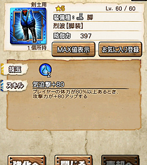

火力防具＼(^o^)／

スキルとしては完全上位となる

エクスプロアの脚がありますが、

防御は烈水の方が高いので

防御不足の場合はこちらでも良いですね！！

防御はどれも400超となっているので

とても高い！！

### ▼烈水武器

#### 烈水の大剣

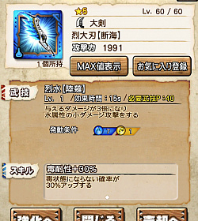

毒耐性30%( ´ ▽ ` )ﾉ

この中途半端なスキルの使い方は

クイーンやクオイズの頭が毒耐性70%なので

その組み合わせで100%にします(๑˃̵ᴗ˂̵)و

または、毒護身の水宝紋というお守りを使用し、

このお守りが25%なので

残り50%の防具を加えて100%にします＼(^o^)／

ティガの大剣ととても似てますね( ´ ▽ ` )ﾉ

アクションスピードが上がらない分、

少し難易度高いですね＼(^o^)／

火力は、技玉も軽く武技時間も長いので

こちらの方が見込めますね！！

#### 烈水の太刀

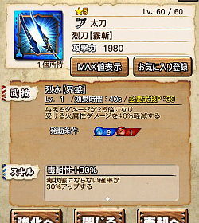

これも同じく毒耐性30%。

武技P20で40秒は燃費良いですね＼(^o^)／

火力は絶望的ですが、

前衛で盾役としてなど( ´ ▽ ` )ﾉ

#### 烈水の片手

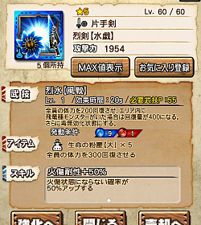

対飛竜という条件を満たせば

アルゲンナイフ並の回復力を誇る武器＼(^o^)／

さらには4人パーティを毒無効化状態にして

自分は火傷耐性も付いている。。

毒無効化とは、すでに毒状態のハンターの解読もでき、
 もちろん効果時間中は毒状態になりません＼(^o^)／

金銀劇毒などで苦戦する方は

これが一人いるだけでかなり安定しそうですね＼(^o^)／

今後の高難度クエストでも

使用できる機会があると思います( ´ ▽ ` )ﾉ

#### 烈水の双剣

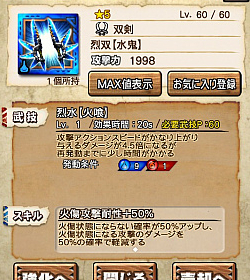

クールタイムが少し長めの武技。

その割に火力もそこそこで、

中途半端な武器ですね！！

その代わり、火傷攻撃耐性がついています( ´ ▽ ` )ﾉ

#### 烈水のハンマー

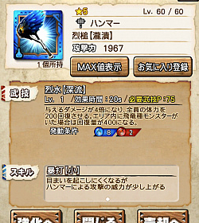

火力が少し上昇し、条件により400回復という武技。。

暴打スキルが邪魔していますね笑

#### 烈水の笛

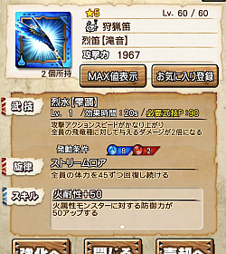

武技レベル最大にしても武技P70が必要となります。。

かなり重いですが、

効果内容は笛としては優秀。

技玉も結構重いので

まだ使いこなせる人は少ないでしょう！！

#### 烈水のランス

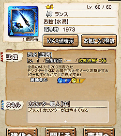

常に等倍の回復役武器( ´ ▽ ` )ﾉ

にしては武技Pが重いので回復力が低い。。

#### 烈水のガンス

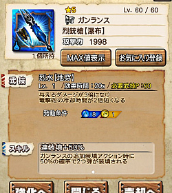

とてもバランスの良いガンス！！

竜擊砲の冷却時間短縮は総火力に大きく影響します♪

さらには連装填が50%です＼(^o^)／

ちなみにティガンスが連装填30%でしたね！

ティガンスでも中々発動してた確率だったと思います♪

フィルティガンスが無い人は全然使えますね( ´ ▽ ` )ﾉ

フィルティガンス、意外と持ってる人少ない笑

#### 烈水のスラアク

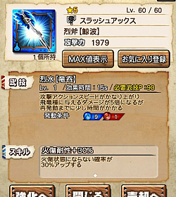

数少ない水のスラです＼(^o^)／

まぁまぁの火力。

スキルは30%と中途半端で

今は無いも同然( ´ ▽ ` )ﾉ

#### 烈水のライト

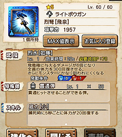

飛竜に6倍というまぁまぁの火力。

そして300回復という中々の回復量＼(^o^)／

今回初の忍び効果もついてますね＼(^o^)／

[裂界変異モンスターとは？ 隠密と忍び効果について](../../../mhxr/monster/crack-gap-mutant-monster/)
 [http://hazieta.com/mhxr/monster/crack-gap-mutant-monster/](../../../mhxr/monster/crack-gap-mutant-monster/)

#### 烈水のヘビィ

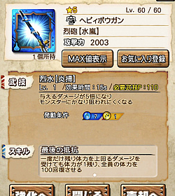

忍び効果が付いてるものの

武技が重いですね( ´ ▽ ` )ﾉ

普通に使ってても役に立たないので

かなり上級者向け武器となりますね＼(^o^)／

#### 烈水の弓

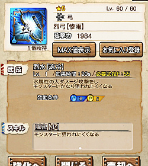

一閃武器。

十六人討伐クエストなどで

武技回数を稼ぐにも武技時間が長いです( ´ ▽ ` )ﾉ

島クエスト用でしょうか＼(^o^)／
