Ver6.4の新モンスが公開されました♪

ゼナセリスでもなく～

もちろん

ショウグンギザミでもなく～

## ナルガクルガ（烈水種）

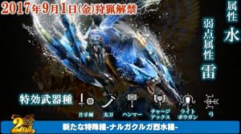

新規モンスでしたね＼(^o^)／

### 烈水種の基本情報

種族 : 飛竜種

弱点 : 雷

特攻武器 : 片手、太刀、ハンマー、チャアク、ライト、弓

スラもガンスも外れています！！＼(^o^)／

バランスは良いと思います♪

これまた楽しみですねー( ´ ▽ ` )ﾉ

チャアクって、

雷属性だとゼクスくらいしか存在しない。。笑

ガチャで新規武器きますかね？！

### 烈水種の特徴

  | 体力 :   | 約688.8万
  | 罠 :   | 約秒
  | 拘束 :   | 効（約秒）
  | スタン :   | 約15秒（1回目）

  | 部位  | 肉質
  | 頭  | 1.30
  | 右前脚  | 1.00（基準）
  | 左前脚  | 0.99
  | 胴  | 1.15
  | 尻尾  | 1.05

烈水は高速移動攻撃をおこなう。

高速移動攻撃は部位破壊をすることで封印することが可能。

### オススメ武器

まずは、新しく実装される武器から♪

#### 月陽の太刀（超レア枠）

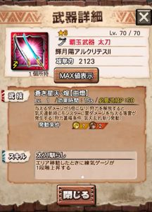

狩力は気刃乱れ斬り2発でMAXとなります♪

これは強いですねー＼(^o^)／

覇玉であり、狩力もある、

やることが多い分、様々なクエストで使用でき

汎用性が高いです(๑˃̵ᴗ˂̵)و

ちなみに、

いなし斬りはガード判定なので

ヒールガーディアンのスキルも付ければ発動します♪

#### XF-07エスパーダ（踏破枠）

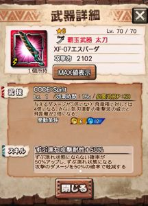

ニャン検隊の1周踏破で確定の武器ですね＼(^o^)／

「確定で星6」というのは珍しく思うかもしれませんが

これまでも月虫やダクティなどがあったのでそれほど♪

この武器は、説明文のとおり衝撃波の2倍は乗算になります( ´ ▽ ` )ﾉ

飛竜に対して8倍の一部乗算なので、

これは発売前から予約殺到しそうですねー＼(▽⌒*)>

私も近頃、火力役が続きましたが

今回はサポート役として

リナーシタを担いでる姿が見えます(๑˃̵ᴗ˂̵)و

#### リナーシタ

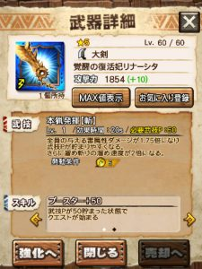

そんなリナーシタw

味方の武技を貯まりやすくしながら

1.75倍のバフ、

さらに大剣でタメ速度2倍、

さらに大剣の達人スキル付という

盛り沢山てんこ盛りの人気武器ですね＼(^o^)／

特に、

味方の武技を貯まりやすくしながら、
 自分自身はスキルをループできる。

というのが強みの武器です♪

#### フィルティの笛

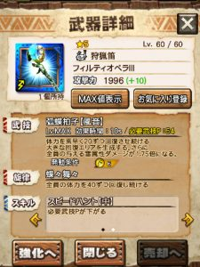

1.75倍のバフと回復の武器ですね( ´ ▽ ` )ﾉ

戦い慣れるまでは

このへんの回復武器を入れるのもアリ(๑˃̵ᴗ˂̵)و

#### トリウムハンマー

スタンすることに関してかなり優秀( ´ ▽ ` )ﾉ

バフはありませんが、

めまい誘発(一閃)と回復もこなす武器。

たとえば、

火力役が3人で、

1スタンで倒せる火力を揃えることができれば♪

烈水の怒る姿を拝むことなく安全に倒せますね(๑˃̵ᴗ˂̵)و

さらに、ナルガ系は

いくつかのアクション時に一瞬だけ

空にいる判定が存在します！

そのときに一閃などでKBを発生させると

撃ち落としになるのでダウンを取れます(๑˃̵ᴗ˂̵)و

それもKBをコントロールすれば狙える武器ですね！！

ただ、等倍ハンマーでKBコントロールは至難の業＼(^o^)／

### オススメ防具

まずはずぶ濡れ装備のおさらいから( ´ ▽ ` )ﾉ

  | 頭  | 星祭(※七夕イベ)、ギギ亜、
  | 胴  | ゼクス、レイスト、凶ペコ、
 シャイン、
  | 腕  | メイド、
  | 腰  | エクスフォース 、
  | 脚  | キリン、

で以上ですかねー＼(^o^)／

では防具♪

#### レイストの胴

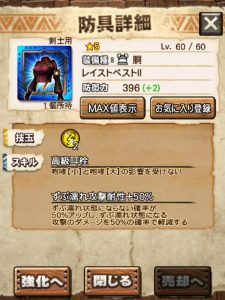

まずはずぶ濡れ耐性から♪

攻撃耐性も付いてるので、

被弾の多いうちでも安心ですね！

さらに進化してる部位なので防御も高い！！

ずぶ濡れ対策でこれを使うので、

戦獄の頭は今回はお留守番気味。

#### ギルドナイト メイドの腕

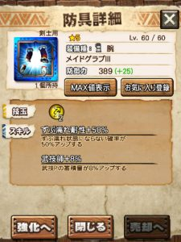

ずぶ濡れ耐性が不足している場合は、

火力の盛りづらい腕で

耐性値を稼ぐのもアリ(๑˃̵ᴗ˂̵)و

武技師も付いてるので

サポート側でも便利な防具♪

#### 水着の腕

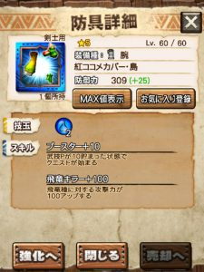

腕でも火力を積みたいなら

少し古い装備ですがこれ＼(^o^)／

ブースターも付いててスキルがとても優秀。

技玉的に雷のエスパーダと相性がよろし。

#### エクスプロア（レア）の脚

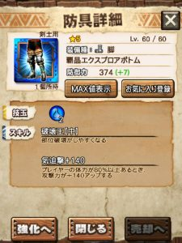

部位破壊をしながら

優勢な戦い方をするなら「破壊王」。

この防具は火力も優秀なので、

そちらの使い方のが多いかもしれませんね！！

これも水なので雷のエスパーダと

技玉の相性がよろし。

#### 七夕の脚

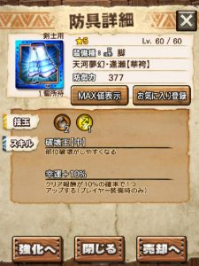

これも破壊王の流れでパート2♪

こちらは超レアと技玉の点で相性よろし。

チームとしての火力が十分であれば

破壊王はいらない気がしますけどねー( ´ ▽ ` )ﾉ

#### リオディオの頭

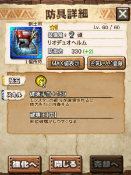

ここまで来たらパート3♪

雷の破壊王なので技玉がきついときに

たまに活躍する掘り出し物防具＼(^o^)／

進化してしまうとパツブレになっちゃうので注意。

進化して持ってないという方は、

もう一つ当てたときにぜひ保管を( ´ ▽ ` )ﾉ

[公式さんの動画]
