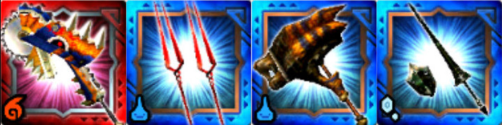
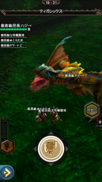

あと数時間で炸裂個体のアグナコトル亜種が解禁ですね＼(^o^)／

このタイミングで

先々月のネタにはなりますが、

同じく炸裂個体である「ティガレックス炸裂個体」の

ワンキル（ワンパン）記事を

過去ログから持ち込みたいと思います～♪

アグ亜はスラアクが特攻武器で火属性弱点にもなっています。

今回ご紹介する編成よりも火力を落として倒せる計算ができますので

参考になればと思います～( ´ ▽ ` )ﾉ

## 炸裂ティガレックスの周回

### ワンキル（ワンパン）編成

①ティグゼーゲ

②ロンギヌスの槍

③ストライプストライク（ティガレックスハンマー）

④アルゲンランス（円でも可）

です( ´ ▽ ` )ﾉ

開幕にロンギの武技「さぁ、約束の時だ」で拘束して、

その間にテガハンでスタンさせ、

あとはいわゆる乱打ティグで

[属性解放突きを3回当てる](../../../mhxr/weapon/krieger-switch-axe-ability/)

ことでワンキルとなります。

当時は、ティガハン2のティグ2なども流行りましたか( ´ ▽ ` )ﾉ

それよりも早く、確実に仕留められます！！

### ワンキル（ワンパン）の手順

手順は、やることが決まってるのでシンプルです♪

ただチームワークは大事で、難易度もやや高めです＼(^o^)／

その分、開幕罠などにはない面白さがあるかもしれませんね( ´ ▽ ` )ﾉ

  | 手順  |  内容
  | STEP1  | テガハンがタメ2をヒットさせる。
 この直後にロンギが拘束を開始する。
 ティグはスラゲージを回収しておく。
  | STEP2  | 拘束中にテガハンはタメ2を2回ヒットさせる。
 この間、ロンギとアル槍は炸裂を壊さない程度にダメージを蓄積しておく。
  | STEP3  | テガが移動する前に乱舞などを使用し、炸裂を壊す。
  | STEP4  | テガハンが4回目のタメ2をヒットさせてスタンさせる。
  | STEP5  | ティグの武技を確認し、アル槍とテガハンは武技を発動する。
  | STEP6  | ティグは[属性解放突きを3回ヒット](../../../mhxr/weapon/krieger-switch-axe-ability/)させて倒しきる。

成功すればこんな感じ＼(^o^)／

必要なスキルとしては、

テガハンが「耳栓」と、

もし間に合わない手順があるようなら

「迅脚」や「高速回避」も有効ですね♪

ティグも「耳栓」。

ロンギはブースター90。

あとは適当な分のブースターと火力があれば！

以上、これを覚えると様々なクエで応用できますー♪

主に、ギルド討伐依頼クエストなどのように、

ある期間で多くのクエをこなさないといけない

ような時のために作った編成でもありました☆

この時は、[タマミツネも同じ手法](../../../mhxr/monster/mizutsune-best-repeat-combi/)で高速周回していましたので

個人でギルチケも100枚はとうに超えていました(๑˃̵ᴗ˂̵)و

ホーク エコールがプラカンし始めたのも

ちょうどこの頃ですねー( ´ ▽ ` )ﾉ

今月も高速周回できそうですね！

ホーク エコールの進化情報ももうすぐです♪

ギルド討伐依頼クエストのイベントが始まるまでに

今回紹介した方法や、アレンジしたものを練習し、

一緒に強くなり楽しめたら幸いです～＼(^o^)／
