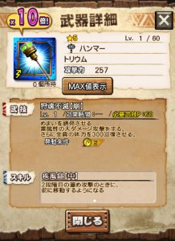
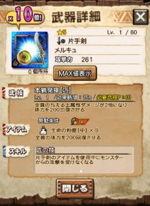

ギルチケ排出と七つの大罪コラボで

多忙なシフトが続きますね～＼(^o^)／

そしてニャン検隊の現在は、

10回派遣で武器確定と防具確定の

2種類のガチャが来ています♪

今回はそれぞれ2周限定という新しい制限と

いつもの次の確定報酬が2倍と5倍の宝箱が今回、

次の確定報酬が10倍

という一個に集約されていますよねー＼(▽⌒*)>

という訳で確率としてはどう変わったのか

計算してから

私自身も挑んでみます＼(^o^)／

## 10倍装備となる確率

以前、[7倍装備となる確率](../../../mhxr/nyan-expedition/7-times-percent/)というのを計算していましたが、

その時の確率は 3.57% でした♪

そのときと同じように

装備確定の前の島で「次の確定報酬が10倍」を

引き当てればよいのですが

その確率は

15.625%

7倍の確率とのみ比べると約4倍！！

ただ、等倍か10倍かの天と地仕様ですね。

7倍のときは2倍の可能性も5倍の可能性もありましたもんね～♪

しかし、2周限定なので

中々厳しい確率～( ´ ▽ ` )ﾉ

## 狩玉150となる確率

10倍とは別に、無課金や微課金の人にとっては

「次の確定報酬が10倍」の後の「狩玉15」の方が

一番のアタリだと思っている人も多いでしょう！

私もその一人です笑

その確率を求めると～

3.33%

。。こっちはきついかな？笑

## 引きの良い一日 ～第3章～

それで、狩玉150を狙いつつ

武器の一周目～

武器10倍を引き当てました笑

結果は

あんまりプラス値いらない系ですけど

割と欲しかった武器は当たりました＼(^o^)／

そして武器の二周目～

また十倍でした笑

（プラス値はさきほどよりも要らない系～）

両方、持ってない武器が来てくれたので

またバリエーション増えそうです♪

しかし、二周両方が10倍装備となる確率って

0.24%

これまた低確率を引き当てましたもんです～♪

正直、第一希望は狩玉でしたけど笑
