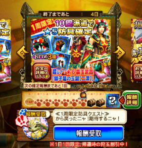
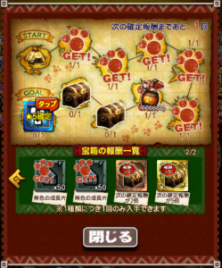
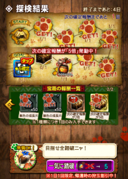
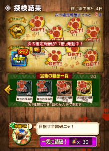
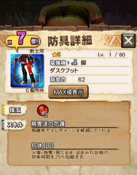
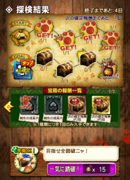
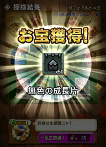
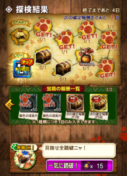
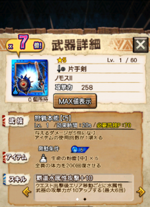

エクスプロアもアップデートしてから2日経ちましたが、

皆さんはオート使いきれていますでしょうか？笑

（私はオートを使い切ったら寝る。の毎日です←）

ところで今、10回派遣で星5確定のニャン検隊が来てるじゃないですか♪

武器と防具で分かれているのですが、

その防具の方、

次の確定報酬が7倍になる

これついに実現させてしまいました＼(^o^)／

夢が一つ叶いました。。

## 引きの良い一日 ～序章～

ジャーン！！＼(▽⌒*)>

これが7倍確定した瞬間♪

いつか実現させたいと思ってましたー＼(^o^)／

普段、頑張っても4島止まりな私にとっては

この大サービスイベントしか狙えなかったのです！！

確率を計算しながら狙える時や狙いたい時に狙ってみる。

これは課金ゲームの一つの醍醐味だと思っています( ´ ▽ ` )ﾉ

そうやって確率を一度計算し

知っていたからこその驚きと喜びでした。

## 確定報酬7倍の確率

このイベントでは、宝箱のある島が8島あります。

数学に強い方なら大体察しがつくと思いますが、

1島目で2倍5倍を引かない確率は75%、2島目では71.43%。。

これらを掛け合わせて求まりますが

その確率、、

3.57%

## 確定報酬7倍の流れ

流れとしては～

こーなって♪

こーなる♪

そして～

もちろんこーなりーの♪♪

次の確定報酬が「7倍」発動中！のメッセージによしっ(๑˃̵ᴗ˂̵)و

7倍～～＼(^o^)／

景品は置いときましょう←

（ガムートで雪だるま耐性は
 付ける気はさらさらないので、
 ガムートの初見に履いていこうかな）

## 引きの良い一日 ～第2章～

7倍の感動に浸りながら

いい気分で他のニャン検隊を動かしていました。

すると防具じゃない方（武器）で

え

え

・・・。

## 武器・防具の両方が確定報酬7倍の確率

えっと

一応計算しますと 3.57% × 3.57% だから

0.127%

麻雀で例えると

小三元やダブルリーチのレベル。。

ポーカーで例えると

フルハウスのレベル。。

少し感動が薄れましたが←

いい経験させてもらいました♪

あ、ちなみに武器の結果( ´ ▽ ` )ﾉ

ポニョ（マーガリタ・ボニニョ）もあるけど

パートナー用として使い分けようかな( ´ ▽ ` )ﾉ
