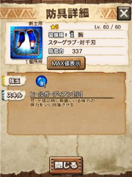
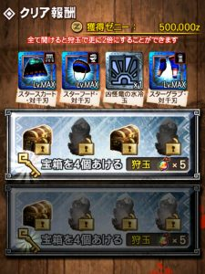
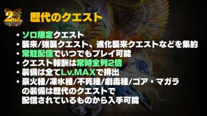

アップデートメンテナンス中ですが♪

おさらい動画がアップされますね＼(^o^)／

入門クエストの実装と

初級クエストについてなどです( ´ ▽ ` )ﾉ

少し見ていきます♪

## 下位クエストの大幅リファイン

### ハンター入門クエストについて

装備貸出でHR固定、

要は、

今始めた人でも行けるクエスト

という位置づけですね＼(^o^)／

たとえば

本日8/29は劇毒

明日8/30は豪火

といった感じに全5属性の

日替わりクエストとなっています～♪

手に入る報酬は、

本日受注可能な劇毒のクエストを見てみますと

武器1種と剣士防具5種

防具はたとえばこんな感じ( ´ ▽ ` )ﾉ

中々面白いスキルついてますね♪

武器がガンスだったのでぴったりなスキル！

あと、中級以上のハンターさんにも嬉しいのが

襲来モンス（ガノやジョーなど）の玉素材や

強襲モンス（豪火や劇毒）の玉素材もでやすく、

さらにお金（ゼニー）もたくさん♪

### 初級クエストについて

###

初級クエストとは、

強襲クエスト（豪火やシルソル、凶暴や鋼膜など）
 襲来クエスト（ガノやジョー、進化襲来など）

となります♪

これは、、

クリア難易度は下げてると思いますが、

周回難易度は上がってしまいましたねー笑

鋼膜など、最速タイムは

かなり落ちると思われます＼(^o^)／

多エリアなども

エリアごとに分担とか出来なくなりますね～( ´ ▽ ` )ﾉ

ただ、報酬は全てレベルMAXなので♪

強化してなくて使えなかった武器や防具も

1つゲットするだけで使えるようになりますね！！

武技レベルは初期レベルなので
 せっかく武技レベルを上げてた武器を
 プラス値に変えてしまわないように
 お気をつけて！！

[公式さんの動画]
