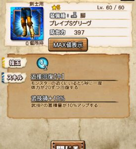

Ver6.4はリファインが大量で楽しいですね＼(^o^)／

9月の星6武器や

ニャン検隊の新しいハズレ枠＆新しいアタリ枠などの

新装備と

あと9月のスケジュールについて見てみましょう( ´ ▽ ` )ﾉ

## Ver6.4アップデート情報

### Ver6.4からの新装備

#### セラス式多属性砲

蒸気式機械重砲って武器の進化ですね＼(^o^)／

予告にはなく、進化一覧サイトで前日に発表されました♪

毎月、少しずつ実装される進化星6で

烈水の玉とチャナガノ亜クエの玉が

進化素材となりますあれです( ´ ▽ ` )ﾉ

レベル70で攻撃力2161です( ´ ▽ ` )ﾉ
 武技は、回復の部分が100→200に進化しています♪
 第2スキルは「スピードハント大」ですー。

。。強いですねー＼(^o^)／

回復力が上がったことで

出番も増えたら良い武器ですね！！

タメ速度が上がる武技は

武技ループができるので強い(๑˃̵ᴗ˂̵)و

大罪の頭や、会心共鳴スキルとコラボしましょう！！

#### クイーンの腰

ガチャのハズレ枠が大出世＼(^o^)／

回避性能スキルの中で現在最上ランクの【中】となり、

一気に使える装備となりましたね＼(^o^)／

ブースターも付いていますので

これをベースに組んでも良いくらいの強さですね！！

進化して防御値も十分です！

どんどん活用していきましょう( ´ ▽ ` )ﾉ

#### ブレイブの頭

ここからはガチャの新しいハズレ枠( ´ ▽ ` )ﾉ

ハズレを進化して

プラス25まで強化すると星6相当になる！！

って予告されていた防具ですね＼(^o^)／

十六人討伐戦で手に入る

ギルドナイト メイドのような防具となります( ´ ▽ ` )ﾉ

頭は、泡耐性がついています！！

泡状態は【小】と【大】がありますので

50％だけでも大きく助けてくれるかもしれません。

まぁ、雷の頭は戦獄の頭があるので

あまり出番はなさそう。

#### ブレイブの胴

胴の風圧無効＼(^o^)／

今後の敵モンスによっては使えるかもしれませんね！

火の胴は割と少ないので

組み込みやすいはずです♪

10月モンスに注目しながら準備しましょう(๑˃̵ᴗ˂̵)و

#### ブレイブの腕

Ｗ還元www

これは根性による不死装備で

まぁ使えるくらいとしか思いつきませんww

#### ブレイブの腰

毒耐性！！

腰の毒耐性は鋼膜ウルクススの腰くらいしか

ありませんでしたので

水技玉用としては唯一無二の存在になりますね＼(^o^)／

超根性までついています♪

#### ブレイブの脚

武技師の脚♪

氷防具の武技師スキルは多いですね＼(^o^)／

サポート武器を担いだとき、

補助の回転率を上げましょう(๑˃̵ᴗ˂̵)و

#### エクスフォースの頭

9月のチャナガノ亜クエスト用ですね！！

。。それだけなら使わないでしょう( ´ ▽ ` )ﾉ

チャナとガノですからね＼(^o^)／

（新規モーションあるのかな？）

#### エクスフォースの胴

武体還元ww

武体還元の使い方は解りません( ´ ▽ ` )ﾉ

前述にもありましたが、

根性からの復帰に使うとすると

底力もあり、スキルのコンボは素晴らしいww

おそらくそういう使い方をしてほしいという防具♪

#### エクスフォースの腕

回避性能【中】ですね＼(^o^)／

高速回避と共に

近ごろ搭載される部位が増えてきました♪

高速回避を別部位で付けて、、

なんてことも良くしますので

蒸気の腕などとスイッチして使用＼(^o^)／

#### エクスフォースの腰

会心共鳴化＼(^o^)／

こちらも近ごろ部位が増えてきました♪

ずぶ濡れ耐性も腰は初( ´ ▽ ` )ﾉ

これがあるだけで

バリエーションがかなり増えますね＼(▽⌒*)>

#### エクスフォースの脚

雷の脚耳栓( ´ ▽ ` )ﾉ

水の技玉も、

雷武器では要求されることが多いので

これが無いとしっくり来ないケースもありそうです＼(^o^)／

炸裂ラギ亜の脚と入れ替えましょう♪

### 9月スケジュール

あざっ種とさんく種は中旬なのですね＼(^o^)／

十六人討伐戦は今月よりは少し早いタイミング♪

ギルチケ排出はまだ未定ですが、

23,24周辺ですかねー( ´ ▽ ` )ﾉ

あとはソロ高難度クエストっていうのが来ますね(๑˃̵ᴗ˂̵)و

狙っている方は

パートナーとオトモの準備をしておきましょう！！
