Ver6.4のアップデート情報としまして～

やはり来ましたね！

大量の装備進化が＼(^o^)／

上位ハンターお待ちかねの

ホーク・エコールの進化

も予告通り含まれています(๑˃̵ᴗ˂̵)و

さて♪1つ1つ見ていきましょう♪♪

## アップデート（Ver6.4）で進化可能な防具

### ▼武器の進化

まずは武器から～♪

#### スチムロック

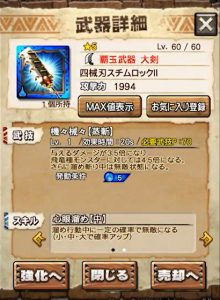

武技を発動するとタメ中は無敵状態となる大剣ですね！

覇玉となり、タメ中に移動できるようになるので

無敵移動できる訳ですね！！

また面白い武器となりました＼(^o^)／

ホーク エコールのクエストでも

よく使用される武器の1つですね！！

#### スタンビード（エクスプロアのハンマー）

エクスプロアのハンマーですね♪

ハンマー用のスキルがついており、

武技にめまい誘発しやすくなる効果もついています♪

火力は期待できませんが

スタン役としては優秀( ´ ▽ ` )ﾉ

ただこれまでは、

バフもめまい誘発(一閃)もないため

あまり使用されることはありませんでした。

覇玉となることで選択肢入りするかもですね＼(^o^)／

#### フィルティレイピア

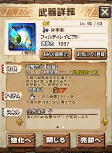

状態異常回復も付いている回復武技の片手( ´ ▽ ` )ﾉ

全方位ガードが付きましたが、

変化はそれくらいですね！！

個人的には回復武器としては

アルゲン片手の方が好きです♪

#### エクエスレヴィエ

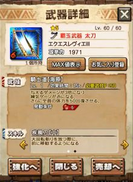

Ver6.4からの新たな覇玉、太刀です＼(^o^)／

武技発動時に練気ゲージがMAXになります♪

覇玉太刀は練気ゲージの赤ゲージを貯めることで

新たなゲージ「心眼ゲージ」も貯めることができます♪

武技で貯めた赤ゲージも対象となります♪

なので武技と覇玉の相性はいいですね！！

さらに、疾風刀は大回転斬りの移動距離UPのスキル♪

これは覇玉太刀の新アクション「いなし斬り」の

移動距離もUPします！！

覇玉太刀のためのスキルがモリモリの武器ですねー♪

火力はありません笑

#### ルヴァングラマサ

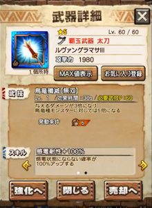

これも覇玉太刀ですね♪

ペコ用にしても火力がありません笑

覇玉太刀の練習武器に( ´ ▽ ` )ﾉ

#### レゲス

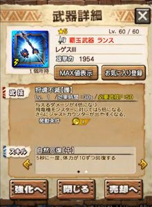

Ver6.3で覇玉となったランスですね！！

覇玉ランスとなることで、

火力が大幅UP。

カウンターのチャンスが多い敵は

今のところ少ないですが、

今後、使える機会はありそうですよね＼(^o^)／

今開催中の災凶ギギネブラ劇毒種なんかで

使えると予想していましたが、

KBだらけモンスだったので残念でした( ´ ▽ ` )ﾉ

#### 戦獄剣斧

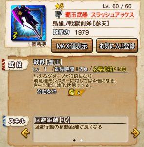

毒無効のスラアクですね( ´ ▽ ` )ﾉ

劇毒がハンターにとって驚異的であった時代に

良く使用されました。。←

覇玉スラ持ってない人は練習に←

#### アルゲンエッジ

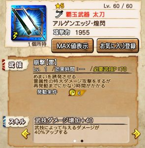

また武技ダメージが増えましたね♪

前回進化のときにナルガやガノを

ワンキルしまくり猛威を振るっていた

アルゲンの太刀＼(^o^)／

覇玉太刀となり、攻撃力も武技ダメも増え、、

相変わらずの強さですね！！

ハンマーの補助もできます(๑˃̵ᴗ˂̵)و

### ▼防具の進化

続いて防具っ(๑˃̵ᴗ˂̵)و

こちらも大量ですが、

アップデートまでにまだ増えるそうです( ´ ▽ ` )ﾉ

#### キャロルの頭

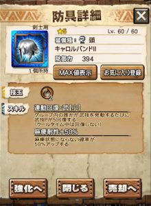

年末にあったニャン検隊の～

キリンキラーと麻痺耐性ついてた頭防具ですね＼(^o^)／

今となっては不要なキリンキラーが無くなり、

変わりに炸裂アグ亜と同じ「連動回復・武」がついてますね( ´ ▽ ` )ﾉ

クールタイムの短い系やサポート系の武器、

特にシャガ笛とは技玉的にもピッタリです！！

#### フィルティの脚

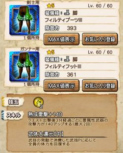

武体大還元となり

まだ使えるようにはなりました＼(^o^)／

自分だけが回復する武体還元とは大きな違いです♪

熟成スキルも高難度クエなどで使えますね！！

金銀劇毒で活躍しました＼(▽⌒*)>

#### 戦獄の脚

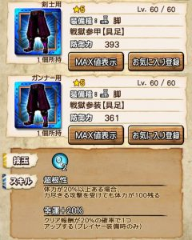

幸運ww

これは予想外でした。

幸運100%に出来ない人のための進化( ´ ▽ ` )ﾉ

#### マグナソルナの胴

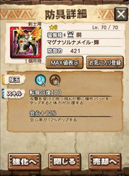

胴の会心スキルで最高値の12%！！！

マグナソルナシリーズでは会心共鳴の腕と

良い勝負していましたが、

ナンバーワンに躍り出ましたね＼(^o^)／

転身回復も中となっています♪

ちなみに転身回復中の回復量は80。

#### マリンの脚

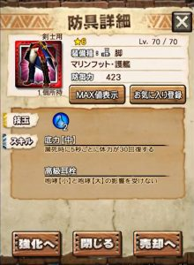

水脚の耳栓ですね( ´ ▽ ` )ﾉ

蒸し腰（蒸鉄卿の腰）と使い分けましょう♪

ただ、烈水ナルガが実装されていない現状では

水の腰は絶望的ww

よってこれまで通り、あまり使用されない一品。

#### アステリの頭

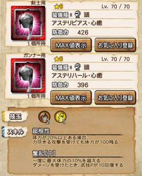

副属性が追加されましたね( ´ ▽ ` )ﾉ

奮起中は同部位でエクスプロアの頭が火玉2。

色んな属性で組み込みやすくなってきましたね！！！

（これ持ってないので欲しいです笑）

#### 飛天ノ胴

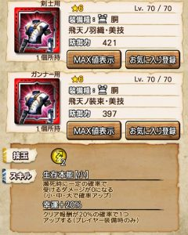

幸運20になっただけでしたね( ´ ▽ ` )ﾉ

少し残念＼(^o^)／

#### 獅妃伝の腰

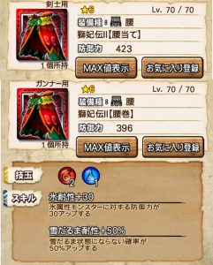

獅子シリーズで最も不要なひと品。

期待してませんでしたが、

副属性追加でしたか！＼(^o^)／

水の腰は本当に少ないので

防御不足な方には良いですね＼(^o^)／

### ホークエコールの進化

ホークエコールの進化情報は次の記事で♪

[⇒ホーク エコールの進化 スキルと性能の評価](../../../mhxr/armor/hawk-ecole-evl-ability/)
 [http://hazieta.com/mhxr/armor/hawk-ecole-evl-ability/
 ](../../../mhxr/armor/hawk-ecole-evl-ability/)

[公式さんの動画]
 ※進化装備一覧の始まりは17:00あたり。
