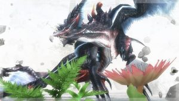

2017年9月度のアップデート情報が小出しで来ましたねー♪♪

内容はこちら！！

早くも

ショウグンギザミ？！

って噂やネタコメントも流れておりますが、

たぶんこっちでしょう♪

## ⇒裂水竜「ゼナセリス」

「れっすいりゅう」という呼称からして裂傷とずぶ濡れ＼(^o^)／

今の情報と状況であればゼナが有力でしょう。

しかし、もしこいつであれば

とても厄介です笑

ずぶ濡れ攻撃はバリエーションも頻度も多く、

裂傷攻撃は長リーチで広範囲となる「垂刃」と呼ばれる部位で攻撃してきます。

剣士であれば大抵の武器種なら

裂傷攻撃は避けられると思いますが、

ずぶ濡れ対策は重要となってくるでしょう！！

ガンナーはヘビなどであれば両方必要になるでしょう。

（そろそろガンナーも使いたい気分( ´ ▽ ` )ﾉ←）

防具としては、

レイオスの胴にずぶ濡れスキルのついでに付いてる耳栓と

蒸し頭（蒸鉄卿の帽子）の飛竜キラーも活かされますね！！

あとは技玉不足を補うために、

新情報でもオススメされている夜叉の腰。

そして、ずぶ濡れ対策のメイドグラブ。

この辺の防具はきちんと準備しておきたいですね！！

個人的にはこちらを期待したい＼(^o^)／

[20170821追記]
 発表されました＼(^o^)／
 偶然？！飛竜でしたので笑
 準備は上記のまま進めて大丈夫っ(๑˃̵ᴗ˂̵)و←
 [⇒ナルガクルガ烈水種 事前準備と対策、おすすめ装備](../../../mhxr/monster/nargacuga-intense-water-prepare/)
 [http://hazieta.com/mhxr/monster/nargacuga-intense-water-prepare/](../../../mhxr/monster/nargacuga-intense-water-prepare/)
