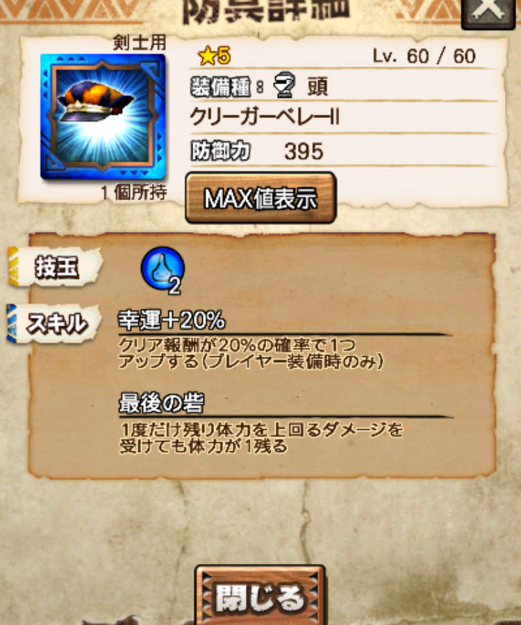
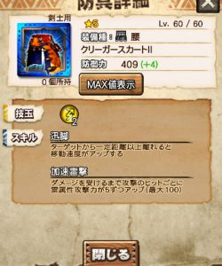
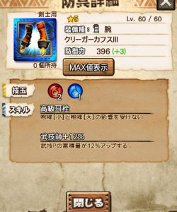
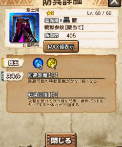
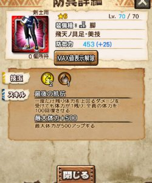

モンハンエクスプロアも、

Ver7.0のアプデが完了しましたねー＼(^o^)／

先月に続き、進化する装備が多いと聞いていましたので

大変楽しみにしておりました( ´ ▽ ` )ﾉ

そんな武器や防具の

スキルを見ながら評価していきましょう(๑˃̵ᴗ˂̵)و

## Ver7.0の新装備

### ノンガチャ系の装備

#### クリーガーの頭Ⅱ

これはとっくに進化済の防具ですね( ´ ▽ ` )ﾉ

今回はクリーガー系の5部位

全てが進化可能となりましたので

ついでに貼っておきます♪

頭と胴は「Ⅱ」という名前に進化済ですね( ´ ▽ ` )ﾉ

#### クリーガーの胴Ⅱ

これも既存ですが一応( ´ ▽ ` )ﾉ

進化したのはついこの間。

#### クリーガーの腕Ⅱ

武技師UP♪

それだけ。

#### クリーガーの腰Ⅱ

進化しただけ( ´ ▽ ` )ﾉ

#### クリーガーの脚Ⅱ

これも進化しただけ( ´ ▽ ` )ﾉ

#### クリーガーの頭Ⅲ

技玉増えてスキルも上位に。

#### クリーガーの胴Ⅲ

弱体化？！笑

技玉は増えましたが

スキルが一つ死にました。。

進化前の方が強いですね＼(^o^)／

クリーガーの最終進化は、

防御変わらずで

技玉が増えたりスキルが変更になったりする感じです( ´ ▽ ` )ﾉ

#### クリーガーの腕Ⅲ

スキルが変更！！

進化前の餓狼スキルは

まだ今は使いこなしにくいスキルです。

進化することで

数少ない「耳栓＋良スキル」の防具となります。

あれば使う機会も多いでしょう＼(▽⌒*)>

#### クリーガーの腰Ⅲ

猛加速に変更( ´ ▽ ` )ﾉ

レア槍で重複しなくなりますね。

#### クリーガーの脚Ⅲ

抗体【大】＼(^o^)／

状態異常の時間半分は実用的かもしれませんね( ´ ▽ ` )ﾉ

複数の状態異常を与えてくる敵も増えてきましたし

選択肢に入れても良いと思います！！

### ガチャ系の装備（星5）

#### ルースの胴

回避性能【中】になりましたね( ´ ▽ ` )ﾉ

胴の回避性能。

#### 戦獄の腰

腰の回避距離【中】と転身回復【中】という

てんこ盛り防具( ´ ▽ ` )ﾉ

中途半端な防具から最前線防具へ＼(^o^)／

### ガチャ系の装備（星6）

#### フィルの胴

火力上がってよし(๑˃̵ᴗ˂̵)و

####  フィルの脚

進化することで、

スキルが全く変わります＼(^o^)／

進化前は熟成スキルで、

金銀劇毒などの長期戦では

素晴らしい活躍をしていました( ´ ▽ ` )ﾉ

まだ使える機会はありますので

被りをお持ちの方は

両方置いておくことをおすすめします＼(^o^)／

####  獅子の腕

★ガンナー用の画像で申し訳ない( ´ ▽ ` )ﾉ

底力が小から中に。

あまり意味のない進化＼(^o^)／

#### 飛天の脚

体力プラスが300から500にｗ

これもあまり意味のない進化( ´ ▽ ` )ﾉ

防御足りていない人はぜひ＼(^o^)／

#### 戦獄の片手

武技が大きく変化。

氷のバフは少ないこともあり、

かなり使い道あります！！

#### 戦獄の虫

武技で飛ばす刃が5本から7本にｗ

月陽の虫をおっかけて続けている武器ですね！！

月陽の虫があれば不要。

#### メルザ

####  エクエスの槍

「めまいが起こしやすくなる」

から

「ひるまなくなる」

に武技の変更( ´ ▽ ` )ﾉ

覇玉にもなるので、

使い道あり＼(^o^)／

#### クリーガーのライトボウガン
