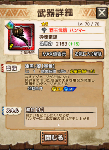

ガムート初日、皆さま楽しめていますでしょうか＼(^o^)／

さっそく黒羽のハンマー（砕塊豪鎚）が出ましたので

性能や評価など、少し考えてみたいと思います( ´ ▽ ` )ﾉ

ガムートさんは、

何でもやりたい放題な相手なので、

気軽に色々試せて楽しいですよね～( ´ ▽ ` )ﾉ

## 砕塊豪鎚の性能

この武器の説明文で解らない点は、

「叩いた地面で大きな爆発が発生」

の部分ですよね＼(^o^)／

まず威力は、少し残念ですが

スタンプ : 1.00（基準）
 角砕き : 2.00
 爆発 : 1.30～1.80（ダメージがまばらで条件わからず‥）

という感じ。

（角砕きと同じアクション値であれと
 祈りながら調べてましたが届かず笑）

見た目は

角砕きからの～

爆発。（見にくかったら申し訳ありません笑）

攻撃判定は、角砕きの3秒後くらいに発生です。

その爆発が、もし武技終了後になれば

もちろん等倍ですが、

武技Pは貯まりません。

そして、爆発はめまい判定となりません。

攻撃範囲は、角砕きほど狭くはなく

スタンプと同じくらいですね( ´ ▽ ` )ﾉ

こうゆう技は、

KB（ノックバック）の多いモンスなどは

攻撃ループできるので強いですよね＼(^o^)／

イベントなどで使える機会を探りたいと思います(๑˃̵ᴗ˂̵)و

[チェリル](../../../mhxr/weapon/cheriru-vs-hellblade-glavenus/)との大きな違いは

ひるまなくなるの効果がない点。

これはかなり大きいので（理由は「チェリル」のリンク参照）

キリンライトなんかとコラボしたい武器ですねー♪♪

## 引きの良い一日～続編～

いつぞや、単純計算だとしても

0.15%以下

を引いたという記事（[ニャン検隊で驚きの確率](../../../mhxr/nyan-expedition/7-times-percent/)）

を書かせてもらいました。

今回の確率は計算できるものではありませんが、

経験と感覚的にはとんでもない確率を

引いたのではないでしょうか＼(▽⌒*)>

今回も一応、麻雀で例えると

比較的、確率の高めな役満クラスに匹敵するかも？！

だってこんな出方ですよ笑

肉まん（マシマシ宝まん）使用時にチケもレアもって、、

どんだけ～
