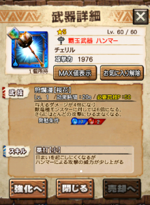
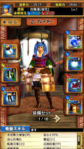
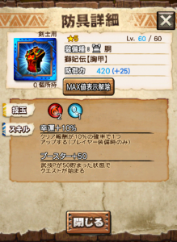

7月はディノバルドとブラキディオス炸裂個体の月でしたね( ´ ▽ ` )ﾉ

ブラキ炸裂は大剣が特攻武器に指定されていたので、

溜め速度が早くなる系の武技を持つ大剣、

代表的にはプラーヴァなどで安定しましたか♪

私も終始プラーヴァでした＼(▽⌒*)>

どちらかというと、

ディノバルドで苦戦した人が多いんではないでしょうか＼(^o^)／

私も何度か野良でいろんな部屋に混ぜてもらいましたが、

虫も、笛も、ハンマーも

プレイヤーの使い方次第で戦況が大きく変わる。

そんな相手だったのだと実感した月でもありました！

厳しい戦いもあり、

個人的には今一番楽しめるクエストですけど♪♪

今日はこのディノバルドについて、

7/1にニャン検隊の確定枠（踏破報酬）にもあり

ハンマーの覇玉武器でもある

「チェリル」

の自分以外、あまりそういう使い方をしてなかったなぁ

と思う担ぎ方を

このタイミングで書かせていただきたいと思います～♪

これを読んで、

既に買った人

たなぼたでゲットした人

持ってる人がチームにいる人

これから手に入れる運命の人

など、ディノバルドで新しい楽しみ方ができる人が

もし現れてくれると嬉しい限りです＼(^o^)／

（私はたなぼたでゲットした人で♪
 今月はとても楽しませてもらいましたー♪♪）

## チェリルの性能

ディノに対しては、武技P50で20秒間6倍となります。

まずはこの、

必要武技P50

といういうのは、

ハンマーにとってはとても扱いやすい値なのです♪

説明しますと

ハンマーのタメ3攻撃は武技P回収に優れています。

具体的には1ヒット目で約6、2ヒット目で約20の

合計25以上もの武技Pを回収できます。

よって、タメ3を2度、フルヒットさせれば50は貯まるのです。

もちろん、振り向きに合わせて2ヒット目のみを当てる場面も

あると思いますので、

その場合は、タメ1やタメ2を追加します。

続いて

武技効果時間20秒

これは覇玉ハンマーにとって

綺麗に使い切れる有意義な時間なのです＼(^o^)／

説明しますと、

覇玉ハンマーの角砕き（タメ3から覇玉ハンマーで派生できる振り下ろし。）

のタメ初めから角砕きまでの一連動作に要する時間が約9秒です。

これをちょうど2発叩き込めることになるのです＼(^o^)／

さらには、チェリルの武技にはスパアマ効果も付いてるので

タメ中や攻撃モーション中に中断されることもありません！！

つまりは、他3人の立ち回り次第で、安定して狙えます♪

## チェリルの使い方

ここからがあまり見かけなかった使い方になってきます♪

私がチェリルを担ぐときはこの装備でした( ´ ▽ ` )ﾉ

回避性能と耳栓用に2部位も使ってしまっていますが、

頭と胴の2部位を火力に使っていますね♪

腕に趣味の奮起が付いていますが笑

腕はメンバさんや狩友さんに合わせて切り替えていました(๑˃̵ᴗ˂̵)و

この通り、火傷耐性も裂傷耐性も無しです＼(^o^)／

裂傷は、スパアマがあるので武技さえできれば怖くありません！！

火傷は、必要武技Pが貯まり武技ができれば、残りは捨てる考えです♪

慣れてきたら、武技も大体50～55くらいを狙って貯まれるので

意外と無駄はないのです！！

まぁ、ディノは火傷攻撃を頻繁にします。

攻撃をキャンセルできるタイミングが増えた覇玉ハンマーでも

避けにくいタイミングはありますね！！

そこで、火傷状態からの武技50の貯め方を紹介しておきます( ´ ▽ ` )ﾉ

武技P0火傷状態

この状態でも、覇玉ハンマーなら

タメ3の2ヒット目（スタンプ）と角砕き、

これだけで武技P50は貯めることができます。

武技してしまえば、火傷は無視で大丈夫ですよね♪

あと、覇玉ハンマー専用アクションの回避振り！

これも重要で、

使ったことのある方はご存知だと思いますが

回避振りはゲージが必要になる分

片手や双剣よりも高速です♪

そして武技P回収はタメ3並（10,13の計23くらい）です♪

さらには回避行動と同じ無敵時間付きとなりますので

武技貯めにはこの上ない方法となります＼(^o^)／

火傷中に高速で貯めて武技するのもアリ

タメ3の2ヒットからの回避振りで貯めるのもアリ（合計約48）

どうでしょうか？

裂傷はまだしも、火傷を無視する点は盲点だった方も

もしかしたらいるのではないでしょうか＼(^o^)／

最後に、私の今の装備セットに

この装備が手に入ったら組み込んでみたい防具( ´ ▽ ` )ﾉ

ブス50、、、これは欲しいです♪

開幕武技できますねー♪♪
