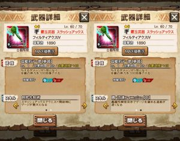

今月の星6進化はフィルティシリーズの

スラッシュアックスでしたよね＼(^o^)／

今回は、炸裂種（今月はアグ亜）の配信前でも

「危険度8レア玉2倍チケット」というのがあるので、

既に進化しましたーって人も居ますね♪♪

やはりというか

オールマイティというか

平凡な性能ですねー( ´ ▽ ` )ﾉ

武技時間は10秒なので

真属性解放突きは[ティグ](../../../mhxr/weapon/krieger-switch-axe-ability/)とは異なり

一発にかけることになりますね！！

ただ、覇玉スラは爆発させるタイミングを

自分で計ることができるのが一つの強み♪

武技も軽いので

多エリアのクエストでも

ばんばん武技していけますねっ(๑˃̵ᴗ˂̵)و

あとはナル亜やベリ亜などの素早い相手とかに

タイミング合わせたりー♪

して、

「ゲージ貯めて→武技して→剣モードで」

としがちですが、

斧モードでも十分な火力出ますので、

「武技して→ゲージ貯めて→剣モードに」

なんてこともできますね♪

いろいろ出来て、

スラアクの新しい使い方できそうなので

作って使う価値は十分にあると思いますー＼(▽⌒*)>

そして、これもマグナソルナの腕と相性いいですね！！

使い道多くて、腕を持ってる人は羨ましいです～＼(^o^)／

フィルスラについてはこのくらいで笑
