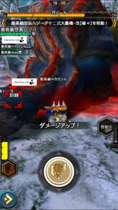
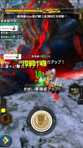
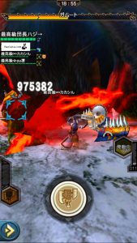
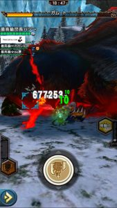

いわゆる「ティグ」は

毎月のようにラインナップされているので、

持っている人も増えてきましたね！！

そんなティグの

武技1回で属性解放突き3回を当てる方法を

簡単に書かせていただきます＼(^o^)／

この「3回」が可能となったのは、

星6の進化が実装されてからなのですが、

見て貰った時にびっくりしたという声も多く、

これまでで一番多かった質問となりますね＼(^o^)／

（画像も貼らせていただきますが、
 ついさきほど、一発本番で撮ったSSです笑
 見難いと思いますが
  スラッシュゲージの残り具合や武技の残り時間に
 注目いただければと思います♪）

## 武技1回で属性解放突き3回の方法

まずは武技発動( ´ ▽ ` )ﾉ

このようにスラッシュゲージが満タンであれば、

ゲージに余裕はありますので、

斧モードのまま武技して大丈夫です♪

そして、

時間の猶予もありますので

変形斬り（剣の抜刀攻撃（武器出し攻撃））を当ててから

属性解放突きに遷移しても大丈夫です( ´ ▽ ` )ﾉ

属性解放突き1回目終わってこの状態。

まだまだ時間の猶予はありますので

位置を少し調整して

2回目も

剣モードへの変形斬りを当ててから

属性解放突きに遷移しても大丈夫です＼(^o^)／

これが2回目の直後。

そしてここから、

抜刀状態からの

突き→薙ぎ払い→斬り上げ

までの3ヒット

もしくは

抜刀攻撃1ヒットからの

ぶん回し2ヒット

により、

属性解放突きが可能となります。

当てれる位置ならそのままやりきって

当てれない位置なら、

ステップ回避でキャンセルしてから

位置調整する余裕は少しあります( ´ ▽ ` )ﾉ

これが3回目の直後。

スクショ撮りながらでも出来る難易度なので

ティグ持ちの方は、

できればマスターしておきたいですね！！

これができるようになれば、

ティグ2でしかワンキルできなかった人も

ティグ1で倒せるようになったり、

今回のガムートなんかは

ハメなくても攻撃し放題なので

総火力のアップなどにも繋がりますよね！！

[20171002追記]
  一応、これらがわかる動画も置いときます( ´ ▽ ` )ﾉ

▼動画「爆氷種ワンキル（開幕スタン失敗時）」【再生時間 : 約70秒】
