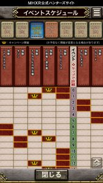
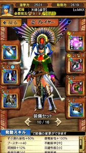

シャガル笛（天笛）の使い方と装備（スキル）について、

沢山の人に聞かれたままで放置していました、ごめんなさい。

今週末には

ホーク・エコールの装備が入手可能な

ギルド討伐依頼クエストも来そうですね！！

シャガルの笛は、

今月の烈水や双チャナでも良く使用されていますし

適正武器です( ´ ▽ ` )ﾉ

ギルド討伐依頼クエストが始まるまでには

ということで、

そろそろ書かせていただきます～( ´ ▽ ` )ﾉ

## シャガル笛（天笛）の使い方

シャガルマガラの狩猟笛です( ´ ▽ ` )ﾉ

これは、シャガルマガラの次に実装された

ライゼクス＆炸裂ラギ亜のときに大人気でしたが、

・無課金で手に入る武器
 ・回復もバフもできる（属性の縛りなし）

という点で、雷モンスだけでなく、

それ以降に実装された様々なモンスで

多くの人に使用されてきました＼(^o^)／

### おすすめ装備

装備は技玉が大量に必要ですので、

なかなか難易度高いですね＼(^o^)／

私が良く使ってきた装備セットを

今風にアレンジして

何点か紹介させていただきます( ´ ▽ ` )ﾉ

基本は、

ホーク胴
 戦獄腕or夜叉腕
 レア腰（エクスプロア腰）

ですね！！

胴は数少ない貴重な土のブースター。

ブースターはシャガ笛では最重要スキルですね( ´ ▽ ` )ﾉ

演奏開始までに

クエスト始まってから1分もかかっていると

それ分ダイレクトにタイムロスとなります(๑˃̵ᴗ˂̵)و

腕は技玉数の優秀さとついでに武技師。

腰は早さが命のシャガ笛の

立ち回りを楽にしてくれる高速回避。

回避性能もモンスによっては

これがないと避けられない攻撃

もありますので時には大事です＼(^o^)／

それでは挙げていきます( ´ ▽ ` )ﾉ

#### ①ブースター、連動回復・武

耳栓なしですので、双チャナなどを想定。

炸裂アグ亜のときに紹介させてもらいました

炸裂アグ亜の頭に付く「連動回復・武(小)」は、

自分自身も回復します。

武体大還元と同じですね( ´ ▽ ` )ﾉ

小の回復量は5ですので

必要武技P35で、武技発動時に武技P5回復。

ブースター60あれば、

おおよそ2回分は確保できてることになりますね！！

#### ②ブースター特化

もっと早く演奏を始めたい場合( ´ ▽ ` )ﾉ

エヴァの頭Ⅱには

ブースターの他に武技師もついてますので

そこそこ安定は保てます♪

脚をベリ亜にすると

私が実際にライゼクスの時に

使用していたセットになります＼(^o^)／

懐かしい‥♪

最近は防御も高くなってきたので

夜叉の腕にするとさらにスピードアップできますね！！

#### ③感電耐性、連動回復・武

感電耐性が必要な場合は炸裂ベリ亜の脚など( ´ ▽ ` )ﾉ

感電耐性の持つ防具は色々ありますので、

脚でなくても、頭でも腕でも♪

脚にして雷技玉をクリアすることで

土のお守りを使える点は優秀。

そして炸裂時代の防具なので防御も高い( ´ ▽ ` )ﾉ

#### ④耳栓、連動回復・武

 耳栓をつける場合はルースの脚など。

腕でも頭でも良いですね！！

#### ⑤ずぶ濡れ耐性、感電耐性、耳栓

今月の烈水用( ´ ▽ ` )ﾉ

十六人の3倍おまを私は持っていませんので

ずぶ濡れ100にはなってませんが

3倍おまを付ければずぶ濡れ100になりますね！！

ルース脚で耳栓もつけておく(๑˃̵ᴗ˂̵)و

### 立ち回り

T.B.R.明日あたりに動画録れたら録ります＼(^o^)／
