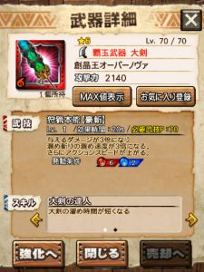

レア大剣（オバフォ）もついに覇玉になりましたねー♪

武技がとても強くて楽しいww

そんなレア大剣を使ってて

ふと思い出しましたのが＼(▽⌒*)>

少し古くなりますが

今年の七夕のイベントのとき。。

ガノトトスがボスで

レア大剣と同じく

溜め斬りの溜め速度が上がる系の武技

のリナやダクティがベタ編成だったと思います( ´ ▽ ` )ﾉ

その時、メンバさんや狩友さんから

「タメ斬り、なんか速くないですか？」

って指摘がありまして、、

「ガード使うんですよ＼(^o^)／また今度教えます！！」

、、と発言して今に至ってしまいました←

はい！！

大剣の使い方として

1つ、必須テクニックを紹介させていただきます＼(^o^)／

## 大剣の使い方

### タメ斬りガードタメキャンセル

タメ斬りは攻撃判定が終わった瞬間から

ガードキャンセルや回り込みキャンセルが

できることはほとんどの人が知っていると思います♪

でもここからがまだ

意外と知られていないのが＼(^o^)／

ガードキャンセルをした際、

タメ斬りをキャンセルしたその

ガードもタメでキャンセルできるのです～＼(▽⌒*)>

タメ斬り→
 ガードキャンセル→
 タメキャンセル→
 タメ斬り

が可能です♪

やり方は、

タメ斬りをしたあとガードキャンセルをする前にタメ始めてタメながらガードキャンセルをする。。。
 （↑真面目に読まなくて大丈夫です笑）

ってややこしいのですが、

少し応用すると最終的には

タメしっぱなしでガードボタンを
 ちょんちょんするだけ

でこれは実現できます( ´ ▽ ` )ﾉ

簡単に動画撮っておきますね～＼(^o^)／

ほんとに、

真ん中の武器攻撃ボタン押しっぱなしで

ガードボタンちょんちょんしてるだけ

なのが解ってもらえると思います♪

知らなかった人はぜひこの機会にマスターし、

レア大剣を使い込みましょう(๑˃̵ᴗ˂̵)و

▼動画「タメ斬りガードタメキャンセル」【再生時間 : 約30秒】
