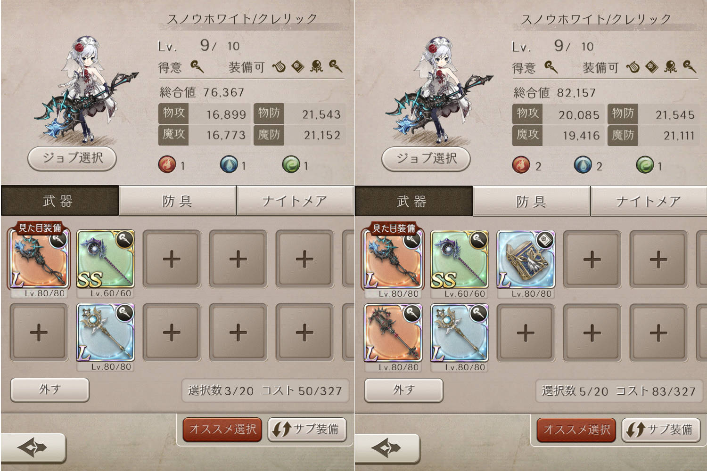

ヒーラーの回復力と装備の関係について、

総合値を上げれば良いのか
 魔法攻撃を上げたら良いのか

など良くわからない！

という質問が多かったので！

簡単に検証してみました～＼(^o^)／

## ヒーラーの回復力について

ヒーラーはもちろん回復してなんぼですよね＼(^o^)／

そして、今の仕様では手数よりも回復量。

一度に回復できる回復量が大きいほど

回復力につながります(๑˃̵ᴗ˂̵)و

その「回復量の増減」について、

攻撃力や防御力のステータスが関係しているかを調べてみます～。

### ヒーラーにとって大事なステータス

はい！

色々試しましたが、

この２枚のスクショで大体わかるかと＼(^o^)／

↑これが比較した２つの装備セット
 （左 : 攻撃高、右 : 攻撃低）

で、これが回復量（左 : 6128回復、右 : 6122回復）

、、解説しますと＼(^o^)／

２つの装備セットはほぼ同じ防御力で、

物理と魔法は関係なく

攻撃力を大きく変えてみました＼(▽⌒*)>

なのに、回復量はほぼ同じとっ(๑˃̵ᴗ˂̵)و

これで

回復量は防御力に依存している

ということが解ります。

回復は支援などと違って

数値として表れるのでとってもわかりやすいですねー♪

ヒーラーの装備セットは、

防御力の高い武器＆防具を探しましょう！！

ということですねー＼(^o^)／

今回はこんな感じで( ´ ▽ ` )ﾉ
