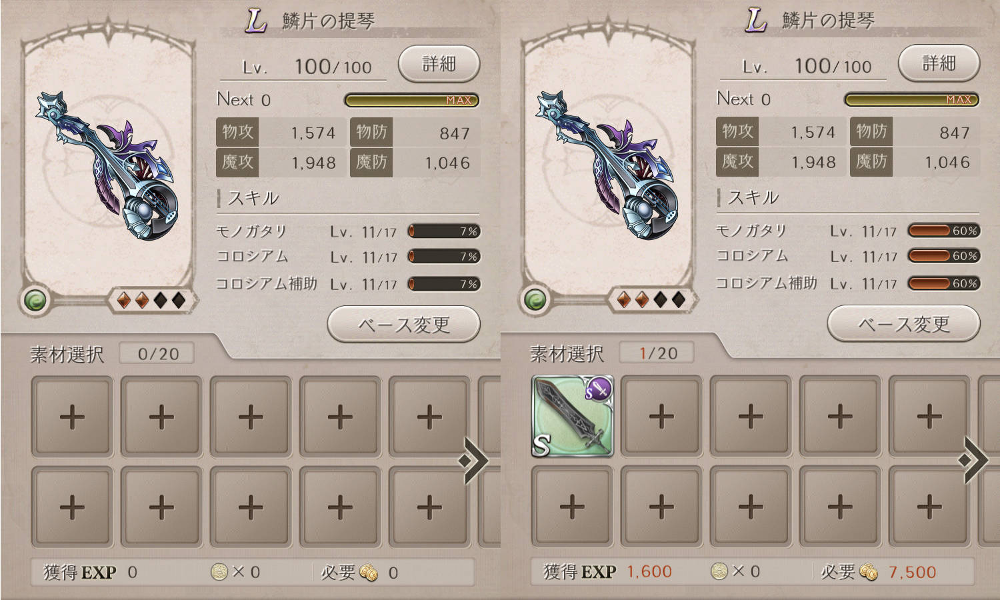
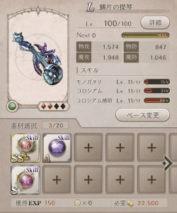
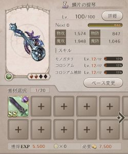
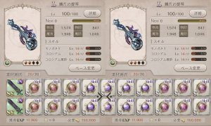
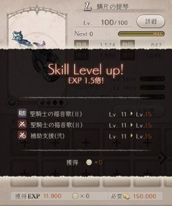

深淵ヘ続ク監獄のイベント、

最近は月１ペースで来ていますね＼(^o^)／

手に入る「監獄ノ鍵メダル」は、

・ドラゴン種対策の海底シリーズの防具×4部位
 ・SS武器（雪花ノ槍）×4（完凸まで）

さえ交換すれば、

あとは魔晶石やオソウジ券だけで、

メダルもすぐ余ってきますよね( ´ ▽ ` )ﾉ

今回実装された

咎人シリーズの「咎人の心」について

使用してみましたので紹介させていただきます＼(▽⌒*)>

## 深淵ヘ続ク監獄イベント

### 咎人シリーズの「咎人の心」

咎人シリーズは、

使い道は何かと言うと

スキルレベル上げ

です( ´ ▽ ` )ﾉ

上昇値はこんな感じ( ´ ▽ ` )ﾉ

宝玉アイテムと比べるとこれ＼(▽⌒*)>

中々ですね！！

でもこれ実は、

進化すると化けるのです＼(^o^)／

進化後はこんな感じ！！

SS宝玉以上ですねー！！

私も使ってみました( ´ ▽ ` )ﾉ

そしてなんと！

大成功ww

### 海底シリーズの防具

ついでに海底防具について少し触れます( ´ ▽ ` )ﾉ

これは主に

「海底ニ巣食ウ火竜(ファフニール)」

という

現在、順番に復刻している内の一つのイベントで

大活躍する防具ですね！！

大活躍というか～

前衛装備の総合値が17万や18万の時点では

必須レベルの防具です。

この復興イベントの特攻ジョブは

人魚姫ですので、

お持ちの人魚姫ジョブに合わせて

海底シリーズの武器種を選び交換しましょう( ´ ▽ ` )ﾉ

おすすめは刀剣ジョブで、

人魚姫の刀剣ジョブはアルカナLV2も

そのうち実装されるでしょう＼(^o^)／
