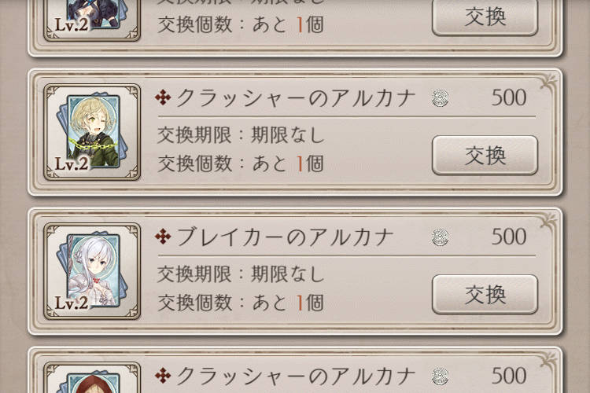
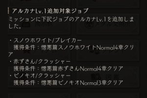
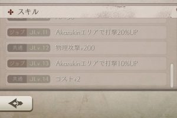

ついに来ましたねアルカナLV2！！＼(^o^)／

9.2アプデ後の～

本日のメンテ後から解禁されますー＼(^o^)／

## アルカナLV2について

### アルカナLV2の入手方法

今回は追加されたアルカナの入手方法は、、

チャームメダルでしたね(๑˃̵ᴗ˂̵)و

他ジョブのアルカナLV1と同じレートで500枚。

ちなみに！

今回の対象4種のアルカナLV1は、、

このお知らせのとおり、

3種が新しくミッションに追加されまして

モノガタリのストーリーから入手可能です( ´ ▽ ` )ﾉ

残り1種(アリス)は前々からあるミッションで

これもストーリーでしたね！

ジョブ自体も

モノガタリのストーリーもしくは

初期から持っているジョブです～♪

つまり！！

モノガタリさえ進めて、チャームメダルさえ集めれば

だれでもジョブレベル14に到達可能ですー＼(^o^)／

### アルカナLV2の効果

予告であったと思いますが

武器コスト最大を増やすことが可能です！！

今回の4種は、、

コスト2もアップ＼(^o^)／

これにより！！

上位プレイヤーさんは

グラコロで入手可能なコスト22の武器も使用可能

となり、

下位プレイヤーさんは

コスト不足で装備できなかったSS武器を使用可能

となりますね＼(^o^)／

さらに、LV13の専用武器10%アップもかなり強い笑

進行中のイベントが落ち着きましたら、

アルカナ入手を優先しても良いでしょう(๑˃̵ᴗ˂̵)و

そして必要熟練度は、、

  | LV12→LV13  | 38,500
  | LV13→LV14  | 57,750

でしたね＼(^o^)／

まだ始めたばかりの私には

大きすぎる数字でした。。
